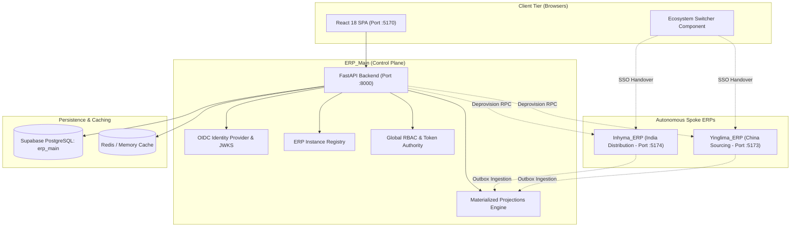

# ERP_Main — System Architecture & Design Specification

**System Role:** Central Control Plane, Identity Provider & Global Projection Hub  
**Architecture Type:** FastAPI Async Microservice + React 18 SPA (Vite)  
**Database:** PostgreSQL (Supabase Cloud Pooler / Dedicated Database Schema)  
**Location:** `ERP_Main/`

---

## 1. Architectural Topology & System Role

`ERP_Main` serves as the authoritative control plane, single sign-on (SSO) identity provider, and global reporting aggregation hub for the entire multi-ERP ecosystem.



---

## 2. Core Architectural Pillars

### 2.1 Central Identity & Single Sign-On (OIDC Authority)
- **Token Issuer:** Issues cryptographically signed RS256 JWT tokens with asymmetric JSON Web Key Sets (JWKS) exposed at `/.well-known/jwks.json`.
- **Ecosystem Session Engine:** Maintains `ihm_ecosystem_session` HTTP-only cross-subdomain cookies tracking authorized spoke ERPs (`allowed_erps: ["inhyma", "yinglima", "control-plane"]`).
- **SSO Handover:** Generates high-entropy, short-lived (60s) single-use authorization tokens allowing seamless user transition between ERP applications without credential re-entry.
- **Identity Preservation:** SSO handover preserves the authenticated user's local name and email (`first_name`, `email`), permanently preventing unauthorized fallback to administrative accounts.

### 2.2 Global Identity, Federated User Management & Access Governance
- **Consolidated User Directory:** Global users and workforce personnel are centrally governed at `/access/users` (`GlobalUsers.tsx`).
- **Triple-Tier Identity Model:**
  - **Platform Administrators (`platform_admins` table):** Central control-plane operators (Super Admin, Platform Admin, Auditor, Support). Features cryptographic password hashing, strict RBAC permissions (`platform_authz`), and the `admin_tokens_revoked_before` epoch timestamp ensuring instantaneous revocation of all active JWTs upon permission revocation, suspension, or credential reset.
  - **Global Users (`global_users` table):** Master identity directory representing every human in the enterprise. Stores authoritative `primary_email` (with functional lowercase B-tree index `ix_global_users_primary_email_lower`), `username`, `display_name`, `phone`, `password_hash` (Argon2id), status (`ACTIVE`, `INACTIVE`, `SUSPENDED`, `LOCKED`), and timestamps.
  - **ERP Spoke Memberships (`erp_memberships` table):** Granular access links binding a Global User to specific autonomous spoke instances (`erp-01` / `inhyma`, `erp-02` / `yinglima`). Tracks `spoke_user_id`, assigned tenant role (`ADMIN`, `USER`, `MANAGER`, `VIEWER`), direct permissions, and activation status.
  - **Spoke Local Users (`users` table in Inhyma & Yinglima):** Autonomous tenant records containing spoke-specific departmental hierarchy, operational roles, branch assignments, and employee links.
- **Direct Access Grants:** Replaced decoupled membership assignment with inline checkboxes (`ERP Access Grants`) in the User Create and Edit modals.
- **Dynamic Provisioning & Deprovisioning:** Granting access automatically provisions a synchronized spoke user; unchecking an ERP access grant invokes the spoke's internal API (`POST /api/v1/internal/users/{id}/deprovision`), soft-deleting the user record on the spoke and invalidating all active sessions.
- **Status Normalization:** Revoked or unassigned spoke access renders cleanly as `None` badges (`Inhyma: • None`).

### 2.3 Conditional Routing Engine (Single-ERP vs Multi-ERP vs Zero-Grant)
- **Zero-Grant / Unassigned Users (e.g. User A, User B, User C, User D):**
  - Users with no spoke memberships assigned (`allowed_erps = ["control-plane"]`) who attempt to log in at spoke ERP login pages (`:5174/login` or `:5173/login`) or navigate directly to spoke routes are automatically redirected via SSO handover to the official central dashboard (`http://localhost:5170/dashboard`).
  - Central login supports flexible identification by primary email, display name (e.g. `User A`), or username prefix.
  - On `ERP_Main`, users with role `NONE` see a dedicated "No ERP Access Assigned" welcome card and their sidebar navigation displays exclusively the `Dashboard` module.
- **Single-ERP Authorized Users:** If an account only has permission for one spoke (e.g. Yinglima only), logging into `ERP_Main` (`:5170`) or another spoke immediately redirects them to their designated spoke ERP with an SSO handover token. The central control plane dashboard and ecosystem switcher are hidden.
- **Multi-ERP Authorized Users:** Users with access to multiple ERPs land on the ERP Dashboard and are provided with the topbar Ecosystem Switcher dropdown across all applications.
- **Platform Super Admins:** Unrestricted access across all registered ERP instances.
- **User Isolation Guard:** All nodes clear local auth state if an incoming SSO handover ticket or ecosystem session cookie targets a different user email than the local cached profile.

### 2.4 Materialized Analytical Projections
- Asynchronously consumes transactional outbox events from spoke ERPs.
- Builds high-performance read-only projections for cross-system executive search, financial metrics, and operational dashboards.
- Features idempotency deduplication (`event_id` tracking) and Dead Letter Queue (DLQ) retry mechanisms.

### 2.5 Bi-Directional Password Synchronization Protocol
- **Single Password Per Identity:** Password updates originating from either ERP_Main or any connected spoke ERP (e.g., Inhyma or Yinglima) are automatically propagated throughout the entire ecosystem without credential drift.
- **Central-to-Spoke Push:** When an administrator or user resets their password in `ERP_Main` (`POST /api/v1/global-users/{id}/reset-password`), the central engine persists the new Argon2id hash in `global_users` and immediately fans out background update calls across all active spoke memberships (`push_password_to_memberships`).
- **Spoke-to-Central Inbound Sync (`POST /api/v1/auth/internal/sync-password`):**
  - When a user changes their password on a spoke (Inhyma or Yinglima), the spoke backend securely notifies ERP_Main via an asynchronous background hook using internal service credentials (`X-Service-Key` / `service_credential_erp_key`).
  - ERP_Main updates `global_users.password_hash` and instantly fans out the new password to all *other* spokes where the user has active memberships (`push_password_to_spoke`), excluding the origin node to prevent sync loops.
- **Graceful Network Fallback:** Password operations never block or fail if a peer spoke is temporarily unreachable; spoken logins automatically verify credentials against the live central ecosystem session, and the Durable Access Sync Engine catches up queued updates.

### 2.6 Durable Access Sync Recovery Engine (`access_sync_tasks`)
- **Fault-Tolerant Deprovisioning:** When an administrator revokes, suspends, or restores user access in ERP_Main, any network error reaching a spoke triggers a durable database record in `access_sync_tasks`.
- **Bounded Exponential Backoff & Leases:** Tasks are reclaimed and retried with distributed worker leases (`claimed_by`, `lease_expires_at`) preventing duplicate execution.
- **Fail-Closed Verification:** Spoke login verification calls ERP_Main's live database state, ensuring that even during synchronization delays, revoked users cannot access spoke ERPs.

### 2.7 Sign-Out: One Session at a Time, "Sign Out Everywhere" on Request
- **Normal sign-out is per session.** Every login has its own session id (see 2.11). Logging out ends that session in the dashboard and in the ERPs it used; other logins of the same account (another device, another browser) and other people are untouched.
- **Sign out everywhere is an explicit, separate action:** `POST /api/v1/global/auth/sign-out-everywhere` and `POST /api/v1/global/user-auth/sign-out-everywhere`. It revokes every `global_sessions` row of the account, stamps `platform_admins.tokens_revoked_before = now` (this also ends admin tokens issued before sessions existed) and force-logs the person out of all of their ERPs (`POST /api/v1/internal/users/{email}/logout`, which revokes all local sessions, invalidates in-flight access tokens and pushes a `FORCE_LOGOUT` (code `4001`) over the live WebSocket).
- **Admin token boundary:** an admin token with a `sid` is valid only while that session is live; a token without one is valid until `iat <= tokens_revoked_before`. The dependencies in `platform_auth/dependencies.py` (`admin_session_is_live`) and `platform_authz/dependencies.py` enforce this on every request, so a disabled admin or ended session fails immediately with `401`.
- Earlier versions of this section named routes and a column that do not exist in the code (`/auth/sign-out-everywhere`, `/auth/internal/revoke-user-tokens`, `admin_tokens_revoked_before`); the real names are used above.

### 2.8 Spoke Multi-Identifier Resolution & Safe Identity Linking
- **Distributed Identity Disambiguation:** In distributed ERP environments, spoke user tables may have independent internal primary keys, legacy integer IDs, or separate UUID sequences.
- **Flexible Identifier Lookup:** Internal spoke endpoints (`/api/v1/auth/internal/revoke-user-tokens`, `/api/v1/internal/users/sync`) accept and resolve any available identifier:
  1. Spoke primary key `id`
  2. Linked `user_id` / `global_user_id`
  3. Authoritative `email`
  4. Unique `username`
- This multi-factor lookup prevents lookup failures when central and spoke primary keys differ, guaranteeing that token revocation and password sync always resolve to the correct local database record.

### 2.9 Platform Role Preservation & Cross-Tenant RBAC Isolation
- **Role Boundary Integrity:** Platform administration privileges in `ERP_Main` and operational roles in spoke ERPs are strictly partitioned.
- **Preservation on Spoke Provisioning:** When provisioning or syncing user accounts to spoke instances, the provisioning engine guarantees that platform administrative privileges (`is_platform_admin`, platform role assignments) are preserved and never overwritten by tenant-level roles.
- **Least Privilege Enforcement:** Spoke ERP administrative roles (e.g. Branch Admin in Inhyma) grant operational power only within that spoke's domain and never escalate to central control-plane authority.

### 2.10 Ecosystem Session Lifecycle, Disambiguated Revocation & Switch Reliability
- **Session-ID Keyed Revocation:** Single sign-out marks `ihm_ecosystem_logged_out=<session_id>` with the exact revoked session ID rather than a generic boolean flag. Other tabs or fresh sessions established via SSO switch or re-login are never falsely diagnosed as revoked.
- **Universal Cookie Cleansing (`clearCookieEverywhere` / `setCookieEverywhere`):** Operates across host-only, `localhost`, `127.0.0.1`, current hostname, and `VITE_COOKIE_DOMAIN`, preventing stale host-level cookies from causing unintended logouts.
- **Watcher Polling Loop Stabilization:** Removed redundant invocation of `clearEcosystemCookie()` inside periodic session verification, stopping perpetual 60-second expiration renewal loops.
- **Server Restart Resilience & DB Persistence:** `PlatformAdmin` logins automatically ensure a mirrored `GlobalUser` row, persisting sessions to `global_sessions` in the database so administrative sessions survive server restarts and multi-worker reload.
- **Accurate Not-Found Disambiguation:** `GET /global/ecosystem-session/{session_id}` distinguishes unknown sessions (`notFound: True, revoked: False`) from genuinely revoked sessions (`revoked: True`), protecting in-flight tokens and handover tickets from premature invalidation.

### 2.11 Session-Scoped Login & Logout (one login = one session id)
**Rule:** every login gets its own session id (`sid`), carried by every token of that login. Signing out revokes that one `sid`.

1. **Opening a session.** Dashboard logins create a `global_sessions` row (platform admins through their mirrored Global User row, so sessions survive restarts and several workers). An ERP login verifies the password locally and then asks ERP_Main `POST /internal/sessions/open`; ERP_Main answers only if the person may use that ERP. The browser stores the `sid` in `localStorage` and the shared cookie.
2. **Switching ERPs** (handover) re-uses the clicking login's `sid`. The target ERP verifies it with ERP_Main (active, same email, ERP allowed) and issues its own tokens carrying that same `sid`. Arriving at the dashboard from an ERP uses `exchange`, which now mints a token bound to that `sid` as well.
3. **Signing out.** The browser calls `POST /global/ecosystem-session/{sid}/revoke` and the ERP's own `/auth/logout`; the ERP's logout also reports the `sid` to ERP_Main server-to-server, so the result does not depend on the browser reaching ERP_Main. ERP_Main revokes the session and tells the person's ERPs (`POST /internal/sessions/{sid}/revoke`).
4. **Per-request enforcement.** Every request checks its token's `sid`: ERP_Main against `global_sessions` (revoked/expired), each ERP against its revocation store (cache + `token_blacklist`) and, for central sessions, against ERP_Main at most every 45 seconds (fail-open).
5. **Fallbacks** (ERP_Main down at login, lost messages, workers, older tokens, stale browser state) are listed in `API_DESIGN_AND_ENDPOINTS.md` 1.4.
6. **Browser rules.** A fresh handover ticket always replaces any saved session; cookie auto-sign-in goes through the same verified exchange (no stored passwords); signing out one login never removes another login's shared cookie; a failed automatic sign-in leaves a visible reason on the login page. Every page that needs the handover shares one exchange (single-flight), temporary failures are retried with growing waits, and the ERP switcher validates the switch before navigating (see `API_DESIGN_AND_ENDPOINTS.md` 1.4).

---

## 3. Directory Layout & Module Decomposition

```
ERP_Main/
├── backend/
│   ├── app/
│   │   ├── api/v1/               # Router aggregation & versioning
│   │   ├── core/                 # App configuration, security, JWT settings
│   │   ├── database/             # SQLAlchemy async engine & session factories
│   │   ├── global_auth/          # Login, refresh, ecosystem session cookies
│   │   ├── global_users/         # Global user entity, CRUD, and password hashing
│   │   ├── platform_roles/       # System-wide RBAC roles and permissions
│   │   ├── erp_registry/         # Registered spoke ERP nodes, URLs, and keys
│   │   ├── erp_memberships/      # Identity linking between global and spoke IDs
│   │   ├── identity_linking/     # Outbound adapters (HTTP, internal RPC)
│   │   ├── oidc/                 # OpenID Connect server & JWKS keys
│   │   ├── projections/          # Cross-ERP event projection consumers
│   │   └── export_engine/        # Secure async CSV/XLSX export service
│   ├── alembic/                  # Version-controlled database migrations
│   └── tests/                    # Backend test suites (85+ automated tests)
└── frontend/
    ├── src/
    │   ├── components/           # AppShell, EcosystemSwitcher, UI tokens
    │   ├── lib/                  # API client, auth context, autocomplete blocker
    │   ├── pages/                # Dashboard, GlobalUsers, PlatformAuthz, ErpRegistry
    │   ├── styles/               # style.css (spin button removal, responsive layout)
    │   ├── App.tsx               # Route definitions & global blocker initialization
    │   └── main.tsx              # React DOM entrypoint & mouse wheel blur lockout
    └── package.json
```

---

## 5. Spoke Machine Identifiers vs. Dynamic Human Branding

1. **Unique Machine Identifier Protocol (`erp-01` and `erp-02`):**
   - The central control plane addresses and syncs spoke instances using unique, stable machine IDs (`erp-01` for port 8002 and `erp-02` for port 8001).
   - Configured in [`config.py`](file:///c:/Users/Inhyma%20Solutions/OneDrive/Desktop/ERP/ERP_Main/backend/app/core/config.py) and mapped in [`http_adapter.py`](file:///c:/Users/Inhyma%20Solutions/OneDrive/Desktop/ERP/ERP_Main/backend/app/identity_linking/adapters/http_adapter.py).

2. **Decoupled Human-Facing Spoke Names:**
   - Display labels and company titles are never hardcoded.
   - The topbar `EcosystemSwitcher.tsx` dynamically queries spoke `/organizations/public` endpoints to render the real company name as configured in that spoke's **ERP Settings -> Company Name**.
   - User provisioning grant checkboxes in `GlobalUsers.tsx` dynamically display `{erp.name || erp.display_name}`.

---

## 6. Idempotent Deployment & Control Plane First-Install Protection

Automated deployment environments (Render, container boot hooks) execute database seeding on initial and subsequent deploy phases.

1. **Bootstrap Force Reset Guard (`BOOTSTRAP_FORCE_RESET` in `backend/scripts/seed.py`):**
   - The seed script verifies whether global users, platform admins, or registry nodes already exist.
   - If existing records are detected, `seed.py` terminates safely without modifying live accounts, credentials, or permissions.
   - Destructive re-initialization is strictly blocked unless `BOOTSTRAP_FORCE_RESET=true` is explicitly provided.
2. **Registry Protection on Local Runs (`backend/scripts/seed_registry.py`):**
   - When developers execute registry seeding locally, `seed_registry.py` preserves cloud production URLs (`https://inhyma-erp-backend.onrender.com`, etc.) unless override environment variables (`INHYMA_ERP_URL`, `YINGLIMA_ERP_URL`) are explicitly provided.
   - Prevents local developer runs from overwriting production routing entries with `http://localhost`.

---

## 7. Platform-Gated Winsock DNS Resilience & Local Port Isolation

In mixed multi-service development environments (running `ERP_Main` on `:8000`, `Yinglima_ERP` on `:8001`, and `Inhyma_ERP` on `:8002`):

1. **Platform Gating (`sys.platform.startswith("win")`):**
   - In `backend/app/core/dns_resilience.py`, DNS caching is applied exclusively on Windows host workstations to eliminate Winsock socket leaks (`WSAEADDRINUSE`).
   - Linux production containers run unaffected with native kernel glibc resolvers.
2. **Port-Sensitive 5-Tuple DNS Cache Key:**
   - Caches `(host, port, family, type, proto)`, preserving exact port destinations and preventing localhost cross-port routing collisions.

