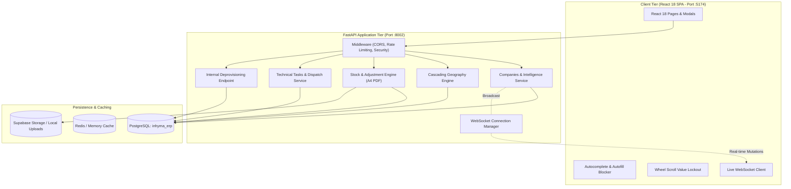

# Inhyma_ERP — System Architecture & Design Specification

**System Role:** India Distribution, Production Planning, B2B Accounts & Field Service Engineering  
**Architecture Type:** Modular Async Monolith (FastAPI) + React 18 SPA (Vite) + WebSocket Real-Time Event Bus  
**Database:** PostgreSQL (Supabase Cloud Pooler / Dedicated Database Schema)  
**Location:** `Inhyma_ERP/`

---

## 1. System Topology & Architectural Pattern

`Inhyma_ERP` manages domestic India distribution, B2B corporate customer directories, stock reconciliation, and field service dispatching.



---

## 2. Core Domain Architectures

### 2.1 B2B Company Domain & Extended Corporate Intelligence
- **Entity Overview:** Complete legal, commercial, and operational profile for domestic clients and suppliers.
- **Extended Intelligence Matrix:**
  - `pincode`: 6-digit postal code.
  - `district_id`: Relational foreign key referencing `districts.id`.
  - `company_category`: Corporate categorization (`Manufacturer`, `Trader`, `OEM`, `Service`).
  - `product_manufacture_or_supply`: In-depth goods manufactured or supplied.
  - `machines_buying_from`: Competitor and vendor intelligence tracking for machinery.
  - `spares_buying_from`: Intelligence tracking for spare parts and tooling.
  - `products_interested`: Target demand and product interest areas.
  - `gst_registration_date`: Tax authority registration timestamp.
  - `age_of_company`: Operational tenure in years.
  - `social_media`: Dynamic JSON matrix `[{"platform": "LinkedIn", "url": "https://..."}, ...]` with an interactive repeater in the UI.

### 2.2 Cascading Geographic Hierarchy (State ➔ District ➔ City)
- **Hierarchical Dependency:** Strict 3-level geographical cascade:
  1. `State` (`/masters/states/lookup`) unlocks `District`.
  2. `District` (`/masters/districts/lookup?state_id=...`) unlocks `City`.
  3. `City` (`/masters/cities/lookup?district_id=...&state_id=...`) filters cities belonging to that district.
- **Cascading Reset:** Changing State resets District and City; changing District resets City.
- **Dynamic City Creation:** Adding a custom city on the fly automatically persists with parent `state_id` and `district_id`.

### 2.3 Inventory Management & A4 Order PDF Generation
- **Stock Ledger:** Real-time visibility into physical on-hand stock, reserved allocations, and net available quantities.
- **Stock Adjustment Vouchers:** Formal reconciliation vouchers (`Stock IN` / `Stock OUT`) for returns, damage write-offs, and count variances.
- **A4 PDF Engine:** Client-side generation using `jsPDF` and `jspdf-autotable` conforming to official corporate tax invoice standards.

### 2.4 Technical Tasks & Field Service Dispatch
- Service call tickets tracking machine models, serial numbers, and warranty status.
- Workflow progression: `Pending` $\rightarrow$ `Allotted` $\rightarrow$ `Under Process` $\rightarrow$ `Completed` / `Cancelled`.
- Searchable technician allotment linked to employee roster.

### 2.5 Leads & Sales Pipeline Engine (`/lead/list`)
- Customer inquiry acquisition channels (`IndiaMart`, `Website`, `Exhibition`, `Cold Call`, `Referral`, etc.).
- Complete lead tracking matrix: company profile, business type, contact person, priority categorization, requirements, allotted sales representative, and lifecycle statuses.
- Real-time typeahead company extraction powered by `ClientNameAutocomplete`.
- Soft-deletion lifecycle with single and bulk delete operations, fully recoverable via Trash.

### 2.6 Purchase Management & Costing Engine (`/purchase/localpurchase` & `/purchase/importpurchase`)
- **Local Purchase Orders:** Full domestic PO workflow with overhead expense absorption (Freight, Handling, Insurance). Calculates dynamic itemized landing costs via the Expense Factor formula and supports atomic inventory stock-in into destination warehouses.
- **Import Consignments:** Multi-currency international purchase tracking with live exchange rates, shipping logistics (BL, vessel, container references), Indian Customs statutory tariff computation (Assessable Value, BCD, SWS 10%, IGST), and dual landing cost matrices (with vs. without statutory duty/tax).

### 2.7 Sales Proforma Invoices & Commercial Terms (`/proforma-invoice/list`)
- Formal B2B quotation and Proforma Invoice lifecycle with independent Billing and Shipping address routing.
- Extended commercial terms: payment terms, delivery timelines, transport carrier, dispatch port, and dynamic RTGS/NEFT corporate bank detail embedding.
- Automatic intra-state (CGST+SGST) vs. inter-state (IGST) tax resolution based on dispatch and delivery state combinations.

### 2.8 Database-Driven Workflow Rules Engine (`app_workflow_rules`)
- Universal status transition framework replacing hardcoded status graphs.
- Enforces role-based permissions (`purchase.local.status`, `purchase.import.status`, `proforma.status`) before permitting entity state mutations.

### 2.9 Federated Authentication, Central Verification & Password Synchronization
- **Central Session Routing & Graceful Login:** Spoke login authenticates locally and simultaneously establishes an ecosystem session with `ERP_Main`. If a user is not authorized for Inhyma, they are redirected automatically to their assigned spoke or to the Central Control Plane. If a recent password change hasn't synced locally, the verified central session completes authentication via SSO handover.
- **Bi-Directional Password Synchronization:** Local password changes (`/auth/change-password` and `/users/{id}/reset-password`) are securely transmitted to `ERP_Main` via `POST /internal/users/password` using internal service credentials, fanning out updates across the ecosystem.
- **Fail-Closed Central Session Verification:** Inbound SSO handover logins verify the central session against ERP_Main's live database via `verify_ecosystem_session()`. Revoked or suspended accounts cannot bypass security checks.
- **Central Identity Protection:** User email addresses are locked to the central control plane (`enforce_central_identity`), preventing local edits from breaking global SSO mappings.

### 2.10 Multi-Identifier Spoke Recognition & Resilient SSO Switching
- **Multi-Identifier Spoke Resolution:** The SSO handover route (`/auth/sso-handover`) accepts any registered alias for the spoke (`{"inhyma", "erp-01", settings.ERP_KEY, settings.ERP_INSTANCE_ID}`). This eliminates cross-ERP switching failures when ERP_Main issues access grants under varying keys.
- **Super Administrator Omnipresence:** Users holding central `super_admin` or `platform_admin` roles are exempt from spoke restriction checks, guaranteeing unconditional administrative access across all nodes.
- **Watcher Polling Loop Protection:** Frontend session watcher (`ecosystemSession.ts`) distinguishes between an unauthenticated state (`notFound: true`) and an active revocation (`revoked: true`). Unauthenticated states retain local sessions and do not trigger infinite reload loops.
- **SSO Switching Fallbacks:** `ssoBridge.ts` passes the caller's target path (`/login?sso_handover=...`) and gracefully falls back to direct navigation if the destination already holds a valid local session.

---

## 3. Frontend Architecture & Platform Hardening

### 3.1 Global Autocomplete & Autofill Blocker (`lib/autocompleteBlocker.ts`)
- Continuously enforces `autocomplete="off"`, `autocapitalize="off"`, `spellcheck="false"`, `data-lpignore="true"` (LastPass blocker), and `data-form-type="other"` (1Password/Bitwarden disabler) across all DOM elements via a `MutationObserver`.
- Capture-phase `focusin` listener intercepts user interactions before browser suggestion tooltips render, permanently removing floating black tooltip bubbles (e.g. `ABC packaging`).

### 3.2 Wheel Scroll Value Lockout & Spin-Button Elimination
- Document-level passive `wheel` listener blurs `input[type="number"]` elements on mouse wheel scroll.
- Universal CSS removes webkit outer/inner spin buttons and sets `-moz-appearance: textfield`.

---

## 4. Directory Layout

```
Inhyma_ERP/
├── backend/
│   ├── app/
│   │   ├── companies/            # B2B company models, routes, intelligence schemas
│   │   ├── masters/cities/       # City master with cascading state_id & district_id
│   │   ├── masters/districts/    # District lookup and relations
│   │   ├── masters/states/       # State lookup and relations
│   │   ├── inventory/            # Stock adjustments & vouchers
│   │   ├── purchase/             # Local & Import PO models, costing, stock-in, and routes
│   │   ├── sales/                # Proforma invoices, commercial terms, and routes
│   │   ├── common/workflow.py    # Database-driven workflow transition validator
│   │   ├── suppliers/            # Supplier directory with mandatory calling number
│   │   ├── technical_tasks/      # Field service tickets & technician dispatch
│   │   ├── api/v1/internal_users.py # Spoke user deprovisioning endpoint
│   │   └── events/               # WebSocket connection manager & broadcast
│   ├── alembic/                  # Database migrations (j1 through o1)
│   └── tests/                    # Backend test suites (38 passing tests)
├── frontend/
│   ├── src/
│   │   ├── components/           # UI design tokens, SideDrawer, ActionMenu
│   │   ├── lib/                  # autocompleteBlocker.ts, api.ts, purchaseApi.ts, workflowRules.ts
│   │   ├── pages/                # Companies.tsx, Suppliers.tsx, LocalPurchasePage.tsx, etc.
│   │   ├── styles/               # style.css (spin button removal)
│   │   ├── App.tsx               # App lifecycle & blocker initialization
│   │   └── main.tsx              # Wheel scroll lockout listener
│   └── package.json
└── doc/                          # System documentation
```

---

## 5. Machine Identifiers vs. Dynamic Human Branding

To achieve complete decoupling between infrastructure routing and organizational branding:

1. **Unique Machine Identifier (`erp-01`):**
   - The backend instance identifier `ERP_INSTANCE_ID = "erp-01"` is defined in [`backend/app/core/config.py`](file:///c:/Users/Inhyma%20Solutions/OneDrive/Desktop/ERP/Inhyma_ERP/backend/app/core/config.py).
   - Used for inter-ERP service-to-service authentication, health reporting, and identity sync across the ecosystem.

2. **Public Branding Contract (`GET /organizations/public`):**
   - Unauthenticated endpoint serving `{ company_name, legal_name, logo_url, erp_id }`.
   - Allows client applications, login pages, and browser tab titles to resolve branding dynamically before authentication.

3. **Dynamic Single Source of Truth (`ERP Settings -> Company Name`):**
   - The human-facing brand name is never hardcoded in source files.
   - All frontend components, document templates, and PDF renderers query `getCachedBrandName()`, which stays synchronized with the active record in the `organizations` database table.

---

## 6. Database Connection Resilience & Production Security

1. **PgBouncer / Supabase Transaction Pooler Statement Cache Auto-Disable:**
   - In [`app/database/engine.py`](file:///c:/Users/Inhyma%20Solutions/OneDrive/Desktop/ERP/Inhyma_ERP/backend/app/database/engine.py), `_statement_cache_must_be_disabled()` automatically detects port 6543 / PgBouncer and sets `statement_cache_size=0` on asyncpg, preventing PostgreSQL `DuplicatePreparedStatementError`.
2. **Production HTTPS Origin Protection & Mixed Content Elimination:**
   - In [`ecosystemSession.ts`](file:///c:/Users/Inhyma%20Solutions/OneDrive/Desktop/ERP/Inhyma_ERP/frontend/src/lib/ecosystemSession.ts) and [`ssoBridge.ts`](file:///c:/Users/Inhyma%20Solutions/OneDrive/Desktop/ERP/Inhyma_ERP/frontend/src/lib/ssoBridge.ts), `isLocalhost()` guards prevent fallback to insecure `http://localhost:*` URLs when served on HTTPS domains (Render, custom domains).

---

## 7. Frontend UI Standard: Universal Filter Control Architecture

To ensure consistent ergonomics, styling, and predictable state across all ERP modules:

1. **Benchmark Reference ([`Companies.tsx`](file:///c:/Users/Inhyma%20Solutions/OneDrive/Desktop/ERP/Inhyma_ERP/frontend/src/pages/Companies.tsx#L5628)):**
   - Header filter toggle buttons across all 20+ modules conform to the exact visual specification of the Companies page filter.
2. **Design Tokens & Constraints:**
   - **Color:** `#556987` solid background (hover `#475569`), invariant across active/open states (never changes to primary blue).
   - **Geometry:** `padding: 8px 14px; border-radius: 6px; border: none; box-shadow: 0 2px 4px rgba(0, 0, 0, 0.1);`.
   - **Dimensions:** Auto width and height (`width: auto; height: auto; min-width: unset`). Removed fixed square dimensions (`38px x 38px`, `min-width: 36px`, etc.).
   - **Iconography:** 16×16px SVG funnel polygon (`points="22 3 2 3 10 12.46 10 19 14 21 14 12.46 22 3"`).
   - **Clean Button Model:** Counter badges and notification dots inside buttons are eliminated to preserve uniform dimensions.
3. **State Invariant:**
   - All filter panels, cards, and drawers are initialized closed (`useState(false)`). Filter panels only expand upon explicit user interaction.

---

## 8. Central Ecosystem Federation & Spoke Resilience

To ensure high availability across multi-ERP control planes (Central ERP_Main, Inhyma, Yinglima):

1. **Candidate URL Discovery (`erp_main_api_base_urls()`):**
   - Combines `ERP_MAIN_URL`, `ERP_MAIN_API_BASE_URL`, `ERP_MAIN_ISSUER`, and `ERP_MAIN_JWKS_URL`.
   - In production, localhost defaults are deprioritized in favor of remote URLs to eliminate configuration drift.
2. **Outbound IPv4 Binding (`_client_for_erp_main`):**
   - Outbound HTTP transports bind to IPv4 (`0.0.0.0`) to avoid unreachable AAAA routing failures on platforms (such as Render) lacking outbound IPv6.
3. **Sleeping Free-Tier Wake-Up Budget:**
   - `SSO_HANDOVER_VERIFY_TIMEOUT_SECONDS` is set to **40 seconds**, accommodating the cold-start spin-up latency of sleeping free-tier control plane containers.
   - Retry loops apply exponential backoff (0.6s to 5.0s) exclusively for transient network errors and 5xx/429 status codes; definite answers (200, 404) terminate immediately.
4. **Stale Session Tolerance (`SSO_HANDOVER_STALE_OK_SECONDS = 900`):**
   - If ERP_Main remains unreachable after exhaustive retries, previously active sessions verified by this ERP within the last 15 minutes are honored from in-memory cache (`_from_cache: True`), preventing user lockouts during transient network blips.
5. **Observability Endpoint (`GET /api/v1/health/federation`):**
   - Provides runtime inspection of live ERP_Main connectivity, probe latencies, environment, and configuration warnings without leaking secrets.

---

## 9. Inbound Email Processing & Atomic Database Deduplication

1. **Database-Backed State (`email_inbound_processed`):**
   - Mail polling deduplication is persisted directly in PostgreSQL (`message_id TEXT PRIMARY KEY, processed_at TIMESTAMP`).
   - Volatile local JSON files are completely eliminated, preventing historical quotation re-creation and runaway AI token consumption upon container reboots.
2. **Atomic Inbound Claiming (`_claim_message_id`):**
   - Uses `INSERT INTO email_inbound_processed ... ON CONFLICT (message_id) DO NOTHING`.
   - Thread-safe and process-safe across multiple background workers.
3. **Cold-Start Baseline:**
   - On the first deployment against a fresh database, emails older than 30 minutes are automatically marked processed to prevent historical message flooding.

---

## 10. Idempotent Deployment & First-Install Seed Protection

1. **Deploy Guard (`BOOTSTRAP_FORCE_RESET`):**
   - On container startup or deployment, [`scripts/seed.py`](file:///c:/Users/Inhyma%20Solutions/OneDrive/Desktop/ERP/Inhyma_ERP/backend/scripts/seed.py) verifies if user accounts already exist.
   - If users are present, bootstrap admin creation, password updates, status toggles, and role link overrides are skipped completely. The active database state is treated as authoritative.
   - Emergency resets require setting `BOOTSTRAP_FORCE_RESET=true` explicitly in environment variables.
2. **Master Geography Protection:**
   - Geography seed scripts verify whether country records already exist, avoiding redundant re-seeding cycles on every release.


