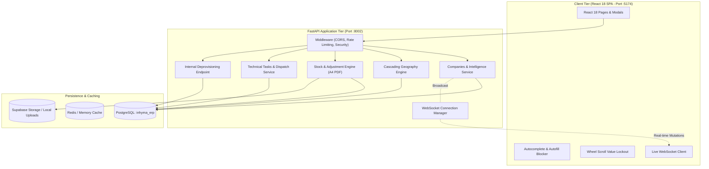

# Inhyma_ERP — System Architecture & Design Specification

**System Role:** India Distribution, Production Planning, B2B Accounts & Field Service Engineering  
**Architecture Type:** Modular Async Monolith (FastAPI) + React 18 SPA (Vite) + WebSocket Real-Time Event Bus  
**Database:** PostgreSQL (Supabase Cloud Pooler / Dedicated Database Schema)  
**Location:** `Inhyma_ERP/`

---

## 1. System Topology & Architectural Pattern

`Inhyma_ERP` manages domestic India distribution, B2B corporate customer directories, stock reconciliation, and field service dispatching.



---

## 2. Core Domain Architectures

### 2.1 B2B Company Domain & Extended Corporate Intelligence
- **Entity Overview:** Complete legal, commercial, and operational profile for domestic clients and suppliers.
- **Extended Intelligence Matrix:**
  - `pincode`: 6-digit postal code.
  - `district_id`: Relational foreign key referencing `districts.id`.
  - `company_category`: Corporate categorization (`Manufacturer`, `Trader`, `OEM`, `Service`).
  - `product_manufacture_or_supply`: In-depth goods manufactured or supplied.
  - `machines_buying_from`: Competitor and vendor intelligence tracking for machinery.
  - `spares_buying_from`: Intelligence tracking for spare parts and tooling.
  - `products_interested`: Target demand and product interest areas.
  - `gst_registration_date`: Tax authority registration timestamp.
  - `age_of_company`: Operational tenure in years.
  - `social_media`: Dynamic JSON matrix `[{"platform": "LinkedIn", "url": "https://..."}, ...]` with an interactive repeater in the UI.

### 2.2 Cascading Geographic Hierarchy (State ➔ District ➔ City)
- **Hierarchical Dependency:** Strict 3-level geographical cascade:
  1. `State` (`/masters/states/lookup`) unlocks `District`.
  2. `District` (`/masters/districts/lookup?state_id=...`) unlocks `City`.
  3. `City` (`/masters/cities/lookup?district_id=...&state_id=...`) filters cities belonging to that district.
- **Cascading Reset:** Changing State resets District and City; changing District resets City.
- **Dynamic City Creation:** Adding a custom city on the fly automatically persists with parent `state_id` and `district_id`.

### 2.3 Inventory Management & A4 Order PDF Generation
- **Stock Ledger:** Real-time visibility into physical on-hand stock, reserved allocations, and net available quantities.
- **Stock Adjustment Vouchers:** Formal reconciliation vouchers (`Stock IN` / `Stock OUT`) for returns, damage write-offs, and count variances.
- **A4 PDF Engine:** Client-side generation using `jsPDF` and `jspdf-autotable` conforming to official corporate tax invoice standards.

### 2.4 Technical Tasks, Field Service Dispatch & Payments Engine (`/payments`)
- **Field Service Tickets:** Service call dispatch tracking machine models, serial numbers, warranty status, and problem descriptions.
- **Workflow Progression:** `Pending` $\rightarrow$ `Allotted` $\rightarrow$ `Under Process` $\rightarrow$ `Completed` / `Cancelled`.
- **Searchable Technician Allotment:** Technician assignments linked to employee roster.
- **Dedicated Payments Module (`/payments`):**
  - **Financial Summary Strip:** Dynamic KPI cards for `TOTAL PAYMENT` (aggregate service charges across all chargeable tasks), `PAID` (total collected in emerald green `#16a34a`), and `DUE` (outstanding balance in slate `#0f172a`).
  - **Dual Tab Architecture:** `Pending` (unpaid or partially paid tasks) and `Completed` (fully reconciled payments).
  - **Dual Amount Visualization:** Clear separation between billable service charge (`Chargable: ₹...`) and payment status (`Paid: ₹...` / `Due: ₹...`).
  - **Payment Collection & Recording Modal:** Live balance due computation, payment mode selection (*Company Acc*, *Self collect*, *UPI / QR*, *Cheque*, *Cash*, *Bank Transfer*), UTR/cheque reference, receipt document upload, and automated call log history generation (`call_type="Payment Collected"`).
- **Navigation & Workflow Streamlining:**
  - Integrated directly into the **`TASK`** sidebar navigation under `Technical Tasks` with custom `₹` currency icon (`IconIndianRupee`).
  - Deprecated and removed legacy `Gatepass` navigation link to maintain a focused task execution dashboard.
- **Zero-Synthetic-Data Enforcement:** Strict repository-wide policy banning automated mock/fake data generation scripts. Preserves authentic system users (`User A, B, C, D`, `Admin`) and ensures honest zero states across all tables.

### 2.5 Customer Relationship Management (CRM) Full Suite & Branded Quotation Engine (`/crm`)
- **Complete Inbound Lead Acquisition:** Multi-channel capture (`IndiaMart`, `Website`, `Exhibition`, `Cold Call`, `Referral`, etc.) with comprehensive lead intelligence (company, contacts, priority, deal valuation, estimated closing dates).
- **Dynamic Lifecycle Pipeline Stages:** Configurable progression stages (`PipelineStage`) with SLA targets, color coding, and win/loss qualification tracking.
- **Interactive Drag-and-Drop Kanban Board:** Visual stage board with real-time deal movement, optimistic drag feedback, and stage sum metrics.
- **Bulk CSV/Excel Import Wizard:** Self-service data onboarding with header fuzzy matching, custom column mapping, preview validations, and duplicate prevention.
- **Round-Robin Sales Distribution Engine:** Automated rules assigning incoming leads fairly across sales team members by geography, source, or rotation index.
- **360° Lead Activity Timeline:** Unified timeline consolidating chronological interaction events (phone calls, meetings, notes, stage advancements, quotation dispatches, and linked tasks).
- **1-Click B2B Company Master Conversion:** Converts qualified leads into permanent enterprise `Company` accounts in the B2B directory, retaining full contact rosters and historical context.
- **Workforce Task Synchronization:** Setting follow-up deadlines auto-provisions assigned tickets in the Workforce Task module with bidirectional linkbacks.
- **Branded ReportLab Quotation PDF:** Server-side engine generating official A4 sales quotations with corporate headers, itemized pricing, tax breakdowns, commercial terms, and signature blocks.

### 2.6 Purchase Management & Costing Engine (`/purchase/localpurchase` & `/purchase/importpurchase`)
- **Local Purchase Orders:** Full domestic PO workflow with overhead expense absorption (Freight, Handling, Insurance). Calculates dynamic itemized landing costs via the Expense Factor formula and supports atomic inventory stock-in into destination warehouses.
- **Import Consignments:** Multi-currency international purchase tracking with live exchange rates, shipping logistics (BL, vessel, container references), Indian Customs statutory tariff computation (Assessable Value, BCD, SWS 10%, IGST), and dual landing cost matrices (with vs. without statutory duty/tax).
- **Uploaded Invoice File Streaming & Zero-Synthetic-PDF Policy:**
  - Dedicated endpoint `GET /api/v1/purchase/import-orders/{purchase_id}/bill-file` streams the **actual uploaded file** attached by the operator in the Add/Edit form.
  - Zero-synthetic PDF policy strictly prohibits generating mock or fabricated invoice PDFs.
  - Multi-format viewer (`ImportPurchasePdfPage.tsx`): renders PDFs in native browser `<iframe>`, images with centered preview, and Word/Excel documents (`.docx`, `.xlsx`) as direct download cards with zero-state notices.
  - Supports `Authorization: Bearer <token>` and `?token=<access_token>` query auth for seamless embedding.
  - **Closed State Action Menu Lock:** When an import consignment reaches `closed` status, the row action menu (`⋮`) is strictly locked to show **ONLY** `Download Purchase`, stripping Edit, Confirm, and Delete operations.

### 2.7 Sales Proforma Invoices & Commercial Terms (`/proforma-invoice/list`)
- Formal B2B quotation and Proforma Invoice lifecycle with independent Billing and Shipping address routing.
- Extended commercial terms: payment terms, delivery timelines, transport carrier, dispatch port, and dynamic RTGS/NEFT corporate bank detail embedding.
- Automatic intra-state (CGST+SGST) vs. inter-state (IGST) tax resolution based on dispatch and delivery state combinations.

### 2.8 Database-Driven Workflow Rules Engine (`app_workflow_rules`)
- Universal status transition framework replacing hardcoded status graphs.
- Enforces role-based permissions (`purchase.local.status`, `purchase.import.status`, `proforma.status`) before permitting entity state mutations.

### 2.9 Federated Authentication, Central Verification & Password Synchronization
- **Central Session Routing & Graceful Login:** Spoke login authenticates locally and simultaneously establishes an ecosystem session with `ERP_Main`. If a user is not authorized for Inhyma, they are redirected automatically to their assigned spoke or to the Central Control Plane. If a recent password change hasn't synced locally, the verified central session completes authentication via SSO handover.
- **Bi-Directional Password Synchronization:** Local password changes (`/auth/change-password` and `/users/{id}/reset-password`) are securely transmitted to `ERP_Main` via `POST /internal/users/password` using internal service credentials, fanning out updates across the ecosystem.
- **Fail-Closed Central Session Verification:** Inbound SSO handover logins verify the central session against ERP_Main's live database via `verify_ecosystem_session()`. Revoked or suspended accounts cannot bypass security checks.
- **Central Identity Protection:** User email addresses are locked to the central control plane (`enforce_central_identity`), preventing local edits from breaking global SSO mappings.

### 2.10 Multi-Identifier Spoke Recognition & Resilient SSO Switching
- **Multi-Identifier Spoke Resolution:** The SSO handover route (`/auth/sso-handover`) accepts any registered alias for the spoke (`{"inhyma", "erp-01", settings.ERP_KEY, settings.ERP_INSTANCE_ID}`). This eliminates cross-ERP switching failures when ERP_Main issues access grants under varying keys.
- **Super Administrator Omnipresence:** Users holding central `super_admin` or `platform_admin` roles are exempt from spoke restriction checks, guaranteeing unconditional administrative access across all nodes.
- **Watcher Polling Loop Protection:** Frontend session watcher (`ecosystemSession.ts`) distinguishes between an unauthenticated state (`notFound: true`) and an active revocation (`revoked: true`). Unauthenticated states retain local sessions and do not trigger infinite reload loops.
- **SSO Switching Fallbacks:** `ssoBridge.ts` passes the caller's target path (`/login?sso_handover=...`) and gracefully falls back to direct navigation if the destination already holds a valid local session.

### 2.11 Workforce Recurring Tasks Scheduling Engine & Automated Worker
- **Dedicated Recurring Sub-Tab (`/tasks`):** Centralized view displaying scheduled repeating tasks, recurrence cadences, active status toggles, and next execution clocks.
- **Flexible Recurrence Scheduling:** Supports Daily, Weekly on selected days, Monthly on specific dates, and custom Cron schedules with interval math.
- **Background Daemon Worker (`recurring_worker.py`):** Asynchronous background worker inspecting active schedules, instantiating transactional tasks upon schedule maturity (`next_run_at <= utcnow()`), applying checklist blueprints and watchers, and advancing execution timestamps safely.
- **Manual Trigger & Lifecycle Management:** Supervisors can manually trigger immediate task creation outside schedule windows, pause running schedules, or archive completed recurring workloads.

### 2.12 Product Sync Integration (Yinglima -> Inhyma) & Relational Provisioning Adapter
- **Cross-ERP Product Sync Adapter:** Connects China Sourcing (`Yinglima_ERP`) with India Distribution (`Inhyma_ERP`) over authenticated REST APIs.
- **Dynamic Dependency Auto-Provisioning:** If an incoming product references a Category, Subcategory, Brand, UOM, or Tax rate not yet present in Inhyma, the adapter automatically provisions the relational master record before inserting the product, ensuring zero foreign key collisions.
- **Deterministic Pagination & Real-Time Broadcast:** Enforces standard `limit` parameter handling, newest-first sorting (`created_at DESC`), and WebSocket push event dispatching (`PRODUCT_SYNCED`) to notify all active client sessions.

### 2.13 Sales Process & Sales Order Lifecycle Architecture (`/sales/process`)
- **Add & Edit Sales Order Engine (`SaleProcessForm.tsx`):**
  - **Proforma Invoice Parity:** Built with strict feature and design parity with `ProformaInvoicesPage.tsx`, ensuring uniform commercial terms, drawer modals, calculation standards, and entity resolution.
  - **Dynamic Masters Integration:** Utilizes `useMasterNames` to dynamically pull active master lists from `/masters/warehouses`, `/masters/payment-terms`, `/masters/transports`, and `/masters/additional-charges`, seamlessly merging them with standard operational fallbacks.
  - **Slide-Over Drawers:**
    - `AddCompanyDrawer`: Integrated alongside `ClientNameAutocomplete` to rapidly register new B2B client profiles without navigating away.
    - `EditAddressDrawer`: Integrated into Billing and Shipping address cards to customize dispatch addresses non-destructively for the order.
  - **Warehouse-Aware Stock Protection & Real-Time Alerts:**
    - Queries `/inventory/product-stock?limit=500` for the selected warehouse (`mumbai`, `ahmedabad`, `indore`).
    - If user enters quantity exceeding available stock: displays prominent top banner (`data-testid="alert-exceeded-stock"`), in-table warning alert, red input border, red warning badge (`Qty: ... ⚠️ Exceeds Available!`), and blur toast warnings.
  - **Grey-Locked Calculation Cells (`#f8fafc`):**
    - Line-item HSN, Taxable Amount, GST %, GST Amount, and Total are readOnly, styled with grey locked styling, dynamically computed as `(unit_price - unit_discount) * quantity`.
  - **Combobox Upward Placement (`placement="up"`):**
    - Combobox dropdowns within table rows open upward, eliminating overflow clipping and scrollbar issues in tables.
  - **Self-Pickup Automation:**
    - Automatically hides Row 3 (Destination, Delivery Type, Delivery Charge) when Transport Name is `Self Pickup` / `Self Pick-up` and relaxes delivery validations.
  - **Default Status Invariant:**
    - Newly created sales orders default to `status: "pending"`.
  - **Payload & Schema Harmonization:**
    - Dual field synchronization (`buyer_name` + `company_name`, `transport_name` + `transporter_name`, `expected_delivery_date` + `delivery_date`, `city`, and `state`) ensures 100% interoperability with backend Pydantic models.

### 2.14 Machine-Spares Compatibility & Component Association Architecture
- **Domain Modeling:** Products are classified by `product_type` (`Machine` vs. `Spare Part`).
- **Relational Mapping (`product_machine_spares`):**
  - High-performance relational join table (`machine_id`, `spare_part_id`, `remarks`, `created_at`) backed by composite uniqueness constraints.
  - Multi-machine compatibility: Standard spare parts (bearings, belts, heating elements) can be simultaneously linked to multiple distinct machine models.
  - Dedicated Machine Spares Page (`MachineSparesModal` / `/masters/products/machine-spares/:machineId`):
    - `Selected` tab: Shows strictly mapped spare components for this machine with rapid unlinking.
    - `All Spare Parts` tab: Global 11-column spare catalog with debounced keyword search and quick `+ Add` / `✓ Added` mapping actions.
- **SideDrawer Elevated Action Header:**
  - `SideDrawer.tsx` features a top-right `headerActions` slot positioning primary editing controls (`Edit Product`) next to the drawer close icon.
  - Machine products display an embedded **Spare Parts** section detailing linked parts with direct `Manage Spare Parts →` routing.
- **Master Catalog Safety:**
  - Row-level `Delete` action button removed from the Product Master list view (`ProductListPage.tsx`) to guard against accidental deletion of core catalog records.

---

## 3. Frontend Architecture & Platform Hardening

### 3.1 Global Autocomplete & Autofill Blocker (`lib/autocompleteBlocker.ts`)
- Continuously enforces `autocomplete="off"`, `autocapitalize="off"`, `spellcheck="false"`, `data-lpignore="true"` (LastPass blocker), and `data-form-type="other"` (1Password/Bitwarden disabler) across all DOM elements via a `MutationObserver`.
- Capture-phase `focusin` listener intercepts user interactions before browser suggestion tooltips render, permanently removing floating black tooltip bubbles (e.g. `ABC packaging`).

### 3.2 Wheel Scroll Value Lockout & Spin-Button Elimination
- Document-level passive `wheel` listener blurs `input[type="number"]` elements on mouse wheel scroll.
- Universal CSS removes webkit outer/inner spin buttons and sets `-moz-appearance: textfield`.

---

## 4. Directory Layout

```
Inhyma_ERP/
├── backend/
│   ├── app/
│   │   ├── companies/            # B2B company models, routes, intelligence schemas
│   │   ├── crm/                  # CRM leads, pipelines, Kanban, distribution, quotations
│   │   ├── masters/cities/       # City master with cascading state_id & district_id
│   │   ├── masters/districts/    # District lookup and relations
│   │   ├── masters/states/       # State lookup and relations
│   │   ├── inventory/            # Stock adjustments & vouchers
│   │   ├── products/             # Product models, specs, and sync_adapter (Yinglima)
│   │   ├── purchase/             # Local & Import PO models, costing, streaming & routes
│   │   ├── sales/                # Proforma invoices, commercial terms, and routes
│   │   ├── tasks/                # Workforce tasks, Jira board & recurring_worker.py
│   │   ├── common/workflow.py    # Database-driven workflow transition validator
│   │   ├── suppliers/            # Supplier directory with mandatory calling number
│   │   ├── technical_tasks/      # Field service tickets & technician dispatch
│   │   ├── api/v1/internal_users.py # Spoke user deprovisioning endpoint
│   │   └── events/               # WebSocket connection manager & broadcast
│   ├── alembic/                  # Database migrations (j1 through o1)
│   └── tests/                    # Backend test suites (38 passing tests)
├── frontend/
│   ├── src/
│   │   ├── components/           # UI design tokens, SideDrawer, ActionMenu, Kanban
│   │   ├── lib/                  # autocompleteBlocker.ts, api.ts, purchaseApi.ts, workflowRules.ts
│   │   ├── pages/                # Companies, Suppliers, LocalPurchase, ImportPurchase,
│   │   │                         # ImportPurchasePdfPage, crm/LeadListPage, crm/LeadKanbanPage,
│   │   │                         # tasks/TasksPage (Recurring sub-tab)
│   │   ├── styles/               # style.css (spin button removal, calc-locked, toasts)
│   │   ├── App.tsx               # App lifecycle & blocker initialization
│   │   └── main.tsx              # Wheel scroll lockout listener
│   └── package.json
└── doc/                          # System documentation
```

---

## 5. Machine Identifiers vs. Dynamic Human Branding

To achieve complete decoupling between infrastructure routing and organizational branding:

1. **Unique Machine Identifier (`erp-01`):**
   - The backend instance identifier `ERP_INSTANCE_ID = "erp-01"` is defined in [`backend/app/core/config.py`](file:///c:/Users/Inhyma%20Solutions/OneDrive/Desktop/ERP/Inhyma_ERP/backend/app/core/config.py).
   - Used for inter-ERP service-to-service authentication, health reporting, and identity sync across the ecosystem.

2. **Public Branding Contract (`GET /organizations/public`):**
   - Unauthenticated endpoint serving `{ company_name, legal_name, logo_url, erp_id }`.
   - Allows client applications, login pages, and browser tab titles to resolve branding dynamically before authentication.

3. **Dynamic Single Source of Truth (`ERP Settings -> Company Name`):**
   - The human-facing brand name is never hardcoded in source files.
   - All frontend components, document templates, and PDF renderers query `getCachedBrandName()`, which stays synchronized with the active record in the `organizations` database table.

---

## 6. Database Connection Resilience & Production Security

1. **PgBouncer / Supabase Transaction Pooler Statement Cache Auto-Disable:**
   - In [`app/database/engine.py`](file:///c:/Users/Inhyma%20Solutions/OneDrive/Desktop/ERP/Inhyma_ERP/backend/app/database/engine.py), `_statement_cache_must_be_disabled()` automatically detects port 6543 / PgBouncer and sets `statement_cache_size=0` on asyncpg, preventing PostgreSQL `DuplicatePreparedStatementError`.
2. **Production HTTPS Origin Protection & Mixed Content Elimination:**
   - In [`ecosystemSession.ts`](file:///c:/Users/Inhyma%20Solutions/OneDrive/Desktop/ERP/Inhyma_ERP/frontend/src/lib/ecosystemSession.ts) and [`ssoBridge.ts`](file:///c:/Users/Inhyma%20Solutions/OneDrive/Desktop/ERP/Inhyma_ERP/frontend/src/lib/ssoBridge.ts), `isLocalhost()` guards prevent fallback to insecure `http://localhost:*` URLs when served on HTTPS domains (Render, custom domains).

---

## 7. Frontend UI Standard: Universal Filter Control Architecture

To ensure consistent ergonomics, styling, and predictable state across all ERP modules:

1. **Benchmark Reference ([`Companies.tsx`](file:///c:/Users/Inhyma%20Solutions/OneDrive/Desktop/ERP/Inhyma_ERP/frontend/src/pages/Companies.tsx#L5628)):**
   - Header filter toggle buttons across all 20+ modules conform to the exact visual specification of the Companies page filter.
2. **Design Tokens & Constraints:**
   - **Color:** `#556987` solid background (hover `#475569`), invariant across active/open states (never changes to primary blue).
   - **Geometry:** `padding: 8px 14px; border-radius: 6px; border: none; box-shadow: 0 2px 4px rgba(0, 0, 0, 0.1);`.
   - **Dimensions:** Auto width and height (`width: auto; height: auto; min-width: unset`). Removed fixed square dimensions (`38px x 38px`, `min-width: 36px`, etc.).
   - **Iconography:** 16×16px SVG funnel polygon (`points="22 3 2 3 10 12.46 10 19 14 21 14 12.46 22 3"`).
   - **Clean Button Model:** Counter badges and notification dots inside buttons are eliminated to preserve uniform dimensions.
3. **State Invariant:**
   - All filter panels, cards, and drawers are initialized closed (`useState(false)`). Filter panels only expand upon explicit user interaction.

---

## 8. Central Ecosystem Federation & Spoke Resilience

To ensure high availability across multi-ERP control planes (Central ERP_Main, Inhyma, Yinglima):

1. **Candidate URL Discovery (`erp_main_api_base_urls()`):**
   - Combines `ERP_MAIN_URL`, `ERP_MAIN_API_BASE_URL`, `ERP_MAIN_ISSUER`, and `ERP_MAIN_JWKS_URL`.
   - In production, localhost defaults are deprioritized in favor of remote URLs to eliminate configuration drift.
2. **Outbound IPv4 Binding (`_client_for_erp_main`):**
   - Outbound HTTP transports bind to IPv4 (`0.0.0.0`) to avoid unreachable AAAA routing failures on platforms (such as Render) lacking outbound IPv6.
3. **Sleeping Free-Tier Wake-Up Budget:**
   - `SSO_HANDOVER_VERIFY_TIMEOUT_SECONDS` is set to **40 seconds**, accommodating the cold-start spin-up latency of sleeping free-tier control plane containers.
   - Retry loops apply exponential backoff (0.6s to 5.0s) exclusively for transient network errors and 5xx/429 status codes; definite answers (200, 404) terminate immediately.
4. **Stale Session Tolerance (`SSO_HANDOVER_STALE_OK_SECONDS = 900`):**
   - If ERP_Main remains unreachable after exhaustive retries, previously active sessions verified by this ERP within the last 15 minutes are honored from in-memory cache (`_from_cache: True`), preventing user lockouts during transient network blips.
5. **Observability Endpoint (`GET /api/v1/health/federation`):**
   - Provides runtime inspection of live ERP_Main connectivity, probe latencies, environment, and configuration warnings without leaking secrets.

---

## 9. Inbound Email Processing & Atomic Database Deduplication

1. **Database-Backed State (`email_inbound_processed`):**
   - Mail polling deduplication is persisted directly in PostgreSQL (`message_id TEXT PRIMARY KEY, processed_at TIMESTAMP`).
   - Volatile local JSON files are completely eliminated, preventing historical quotation re-creation and runaway AI token consumption upon container reboots.
2. **Atomic Inbound Claiming (`_claim_message_id`):**
   - Uses `INSERT INTO email_inbound_processed ... ON CONFLICT (message_id) DO NOTHING`.
   - Thread-safe and process-safe across multiple background workers.
3. **Cold-Start Baseline:**
   - On the first deployment against a fresh database, emails older than 30 minutes are automatically marked processed to prevent historical message flooding.

---

## 10. Idempotent Deployment & First-Install Seed Protection

1. **Deploy Guard (`BOOTSTRAP_FORCE_RESET`):**
   - On container startup or deployment, [`scripts/seed.py`](file:///c:/Users/Inhyma%20Solutions/OneDrive/Desktop/ERP/Inhyma_ERP/backend/scripts/seed.py) verifies if user accounts already exist.
   - If users are present, bootstrap admin creation, password updates, status toggles, and role link overrides are skipped completely. The active database state is treated as authoritative.
   - Emergency resets require setting `BOOTSTRAP_FORCE_RESET=true` explicitly in environment variables.
2. **Master Geography Protection:**
   - Geography seed scripts verify whether country records already exist, avoiding redundant re-seeding cycles on every release.

---

## 11. Frontend UI Standard: Computed Fields "Grey and Locked" Pattern & Universal Empty States

### 11.1 Auto-Calculated and Locked Fields (`.calc-locked`)
To eliminate ambiguity between user-editable inputs and system-calculated or formula-derived values across forms (Local Purchase, Import Purchase, Product Master):

1. **Design Tokens & Specification:**
   - **Background:** `#e9ecef` (light slate grey, immediately recognizable as non-editable compared to pure `#ffffff` user inputs).
   - **Border:** `1px solid #cbd5e1` (slate-300).
   - **Text Color:** `#475569` (slate-600) with `font-weight: 600`.
   - **Interaction:** `cursor: not-allowed`, `user-select: none`.
   - **Iconography:** Optional lock indicator (🔒 or SVG lock icon) on summary cards and expense loading fields.
   - **Dark Mode Token:** `[data-theme="dark"] .calc-locked` (`background: #1e293b; border-color: #334155; color: #94a3b8;`).

2. **Standard CSS Classes ([`style.css`](file:///c:/Users/Inhyma%20Solutions/OneDrive/Desktop/ERP/Inhyma_ERP/frontend/src/styles/style.css)):**
   - `.calc-locked`: Standard class applied to read-only `<input>` elements or `<td>` table cells.
   - `.calc-locked-wrapper`: Flexbox input wrapper with styled prefix/suffix adornments (e.g. `₹` currency symbol, `%` symbol, and lock indicator).
   - `.calculated-field`: Legacy alias maintaining backward compatibility.

3. **Domain Applications:**
   - **Local Purchase Costing:**
     - `Total Of All Expenses` = $\sum(\text{Packing} + \text{Transport} + \text{Offloading})$
     - `% Loading Expense (VB)` = $(\text{Total Expenses} / \text{Invoice Total Without GST}) \times 100$
     - Table columns: `item_total`, `expense_per_unit`, `unit_landing_rate`, `total_landing_rate`.
   - **Import Purchase Customs Costing:**
     - Computed summary cards: `Total Expenses`, `Invoice Total Value (INR)`, `Gross Total Landing (INR)`, `% Loading Expense (VB)`, `Loading Amount per CBM`.
     - Customs Matrix columns: `unit_landing_rate_vb`, `unit_landing_rate_cb`, and line totals.
   - **Product Master:**
     - Dimensions: `packaging_unit_cbm` ($(\text{Length} \times \text{Width} \times \text{Height}) / 1,000,000$).
     - Multi-package totals: `packageTotals.cbm`, `net`, `gross`.

### 11.2 Universal Empty State Standard (`"No Data"`)
1. **Rule of Engagement:**
   - When a data table has completed loading and contains zero matching records, the empty state row MUST display the exact, standardized message: **`"No Data"`**.
   - Fragmented variations (`"No records found."`, `"No suppliers found."`, `"No user accounts found."`, `"No soft-deleted records found."`) are prohibited.
2. **Implementation Pattern:**
   - Full column span: `<td colSpan={columnCount} style={{ textAlign: "center", padding: "36px", color: "#64748b" }}>No Data</td>` or `<TableMessageRow colSpan={columns.length}>No Data</TableMessageRow>`.

---

## 12. Zero-Layout-Shift Floating Toast Architecture & Deprecation of Static In-Page Banners

### 12.1 Architectural Problem & Rationale
Legacy web forms often rendered static inline banners (`.banner`, `.banner-success`, `.banner-danger`, `.error-banner`) directly above cards or form inputs upon saving or error states. This pattern caused severe user-experience degradation:
1. **Jarring Layout Shifts (High Cumulative Layout Shift - CLS):** An inline banner pushes all underlying form controls downward by 40–80 pixels when mounted, causing user mis-clicks and disorientation.
2. **Visual Clutter:** Green or red banners occupied permanent vertical real estate until manually closed or navigated away.
3. **Screen Real Estate Wastage:** On mobile devices or smaller desktop viewports, inline banners push submit buttons below the fold.

### 12.2 Modern Floating Toast Architecture (`toast.tsx`)
Inhyma ERP standardized on an asynchronous floating toast system mounted at the top-level app boundary:
1. **Fixed Viewport Overlay (`.toast-container`):**
   - Positioned fixed at `top: 20px; right: 20px; z-index: 99999;`.
   - Floating notifications do not occupy document flow, guaranteeing **Cumulative Layout Shift = 0**.
2. **Toast Token & Design Specifications:**
   - **Success (`.toast-success`):** Emerald green background (`#059669` / `#10b981`), white bold typography, checkmark icon (`✓`).
   - **Error (`.toast-error`):** Crimson red background (`#dc2626` / `#ef4444`), white typography, alert icon (`✕` / `⚠`).
   - **Warning (`.toast-warning`):** Amber background (`#d97706`), dark slate typography.
   - **Info (`.toast-info`):** Slate blue background (`#2563eb`), white typography.
   - **Typography & Geometry:** Font size `14px`, `font-weight: 500`, padding `12px 18px`, border radius `8px`, with soft drop-shadow (`box-shadow: 0 10px 15px -3px rgba(0, 0, 0, 0.1), 0 4px 6px -4px rgba(0, 0, 0, 0.1)`).
3. **Lifecycle & Micro-Interactions:**
   - **Auto-Dismiss:** Automatically fades out and unmounts after `3500ms` (3.5 seconds).
   - **Manual Dismiss:** Interactive close button (`×`) for instant dismissal.
   - **Hover Pausing:** Pauses auto-dismiss countdown when the user hovers over the notification to read complex error messages.

### 12.3 Accessible Graceful Degradation Pattern
To ensure screen readers, assistive technology, and automated unit test suites (`@testing-library/react`, Vitest) that assert on banner roles (`role="alert"`) or error messages continue to function seamlessly:
- Legacy inline `<Banner>` components render their DOM elements in **`visually-hidden`** mode:
  ```css
  .banner, .error-banner, .success-banner {
    position: absolute;
    width: 1px;
    height: 1px;
    padding: 0;
    margin: -1px;
    overflow: hidden;
    clip: rect(0, 0, 0, 0);
    white-space: nowrap;
    border: 0;
  }
  ```
- Additionally, `<Banner>` mounts a `useEffect` trigger that automatically dispatches the message to `useToast()` if provided.
- This guarantees 100% test compatibility (zero broken tests across 160+ unit tests) and full WCAG accessibility while giving end users an ultra-smooth, modern floating toast experience.

---

## 13. Universal Page Header, Action Buttons Standard & Filter Hierarchy

### 13.1 Page Header Geometry & Spacing
To ensure pixel-perfect vertical alignment and zero visual discrepancies across all ERP modules:
1. **Container Padding (`.page`):** Standardized to `padding: 12px 20px;`, establishing a consistent 20px horizontal margin matching the edges of tables, filter panels, and KPI cards.
2. **Page Header Spacing (`.page-header`):** Standardized with `margin-bottom: 16px; display: flex; justify-content: space-between; align-items: center;`.
3. **Phantom Gap Elimination:** Feedback banner wrapper elements are conditionally rendered only when an error or success message exists (`{(error || success) && ...}`), preventing empty vertical voids below headers.

### 13.2 Universal Header Action Buttons (`.page-header-actions`)
All primary and secondary actions in top-level page headers adhere to a strict universal geometry:
1. **Geometry & Font Tokens:**
   - Exact `height: 35px !important;` (`min-height: 35px; max-height: 35px; box-sizing: border-box;`).
   - Exact `border-radius: 6px !important;`.
   - Typography: `font-size: 13px !important; font-weight: 600 !important; line-height: 1 !important;`.
   - Layout: `display: inline-flex !important; align-items: center !important; justify-content: center !important; gap: 10px !important;`.
2. **Targeted Controls:** Applied uniformly across `.btn-filter-toggle`, `.btn-add-new`, `.btn-quick-add`, `.btn-imp-exp`, `.btn-bulk-actions`, `.stock-btn-export`, etc.
3. **Dropdown Popover Isolation:** Dropdown menu buttons inside absolute popovers (`.page-header-actions div[style*="absolute"] button`) are explicitly isolated with `height: auto !important; min-height: unset; justify-content: flex-start !important;` so menu item layout remains unconstrained.

### 13.3 Filter-Above-KPI Architectural Hierarchy
Across all listing and operational views containing KPI summary statistics, the DOM and visual hierarchy places filter panels **directly above** KPI metric summary cards:
1. **User Workflow Rationale:** Users refine their search and scoping criteria before analyzing aggregated numerical totals. Placing filters above KPI cards ensures users intuitively understand that the metrics below reflect the active filter parameters.
2. **Implemented Modules:**
   - **Payments:** Filter Panel ➔ 3 Top KPI Cards (`TOTAL PAYMENT`, `PAID`, `DUE`) ➔ Data Table.
   - **Sale Process:** Filter Panel ➔ 6 Top KPI Summary Cards ➔ Status Tabs & Table.
   - **Price List:** Filter Panel ➔ 4 Top KPI Cards ➔ Table.
   - **Import Purchase:** Filter Panel ➔ Dynamic Workflow KPI Cards ➔ Status Tabs & Table.
   - **Product Stock:** Machine Lookup & Warehouse Filters ➔ KPI Strip ➔ Data Table.
   - **Discount Payments:** Filter Panel ➔ 3 Top KPI Cards ➔ Table.
   - **Technical Tasks:** Filter Panel ➔ Status Tabs & Main Card.

### 13.4 Minimalist Header Standard
To eliminate visual clutter on high-frequency operational pages, verbose descriptive subtitles under main page headings (e.g. on `Trash.tsx` and `Audit.tsx`) are removed, keeping page titles bold, focused, and immediately scannable.

---

## 14. Database Migration Governance & Container Deployment Lifecycle

### 14.1 Alembic Single-Head Invariant
- **Single-Head Contract:**
  - Automated tests (`tests/test_migrations_match_models.py::test_single_migration_head`) strictly enforce `len(heads) == 1`.
  - Divergent branches generated by independent feature developments must be reconciled with an explicit merge migration (e.g., `alembic/versions/d32a657d3f2f_merge_inventory_and_crm_heads.py`).
- **Idempotent DDL Design (`sa.inspect`):**
  - Migration scripts inspect the database metadata via `sa.inspect(conn)` before executing `op.create_table` or `op.add_column`, ensuring safe re-execution on production databases with pre-existing schemas.

### 14.2 Container Bootstrapping Pipeline (`server.py`)
During Render/Docker container boot, `python server.py` executes a four-phase initialization pipeline:
1. **RB-03 Version Reconciliation (`scripts.reconcile_alembic_version`):**
   - Detects orphaned or corrupt version hashes in `alembic_version` table and re-aligns them with applied schema state.
2. **Schema Upgrade (`alembic upgrade heads`):**
   - Executes `alembic upgrade heads` (plural), upgrading all active branch heads to current state without terminating container execution on branch divergences.
3. **Idempotent Bootstrap Seeding (`scripts.seed`):**
   - Provisions roles, permissions, geography, and default super-admin credentials if not already present.
4. **ASGI Process Launch (`uvicorn app.main:app`):**
   - Starts API server with DNS resilience and graceful shutdown signal handlers.
