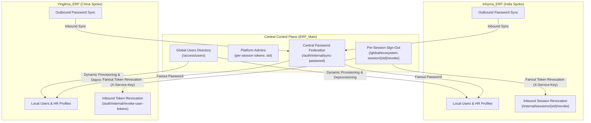

# Multi-ERP Enterprise Platform

A distributed, federated multi-ERP ecosystem engineered for high-availability international procurement, domestic distribution, and global analytical oversight.

---

## 1. System Ecosystem

The ecosystem comprises three autonomous systems:

1. **`ERP_Main` (`/ERP_Main`)**
   - Central Control Plane, Identity Provider & Global Reporting Hub
   - FastAPI Backend (Port `8000`), React + TypeScript SPA Frontend (Port `5170`)
   - OIDC Federation Authority, Global ERP Registry, Platform RBAC, Event Inbox, Real-Time Projections, Multi-Entity Search, Secure CSV/XLSX Export Engine.

2. **`Yinglima_ERP` (`/Yinglima_ERP`) — Spoke Machine ID `erp-02`**
   - Autonomous Procurement & Sourcing ERP (China Export / Factory Sourcing)
   - FastAPI Backend (Port `8001`), React + TypeScript SPA Frontend (Port `5173`)
   - Dynamic branding resolved from `ERP Settings -> Company Name` via unauthenticated contract `GET /organizations/public`.
   - Local Argon2id Auth, Buyers, Suppliers, Master Data, Inquiries/RFQs, Vendor Quotations, Planning Sheets with MUM group tracking, Transactional Outbox, Relying-Party SSO Client, Standalone Background Queue Worker.

3. **`Inhyma_ERP` (`/Inhyma_ERP`) — Spoke Machine ID `erp-01`**
   - Autonomous Production Planning & Distribution ERP (India Domestic Distribution)
   - FastAPI Backend (Port `8002`), React + TypeScript SPA Frontend (Port `5174`)
   - Complete visual uniqueness across all 39 sidebar routes with dedicated SVG icons.
   - Standardized universal UI design system: uniform header filter toggle buttons across all modules (`#556987`, 8×14px, badge-less, default collapsed state).
   - Dynamic branding resolved from `ERP Settings -> Company Name` via unauthenticated contract `GET /organizations/public`.
   - Local Argon2id Auth, Enterprise Tasks Module v2 (Jira-style boards, escalations, holds), Master Data, Inquiries, Planning Sheets, Transactional Outbox, Standalone Background Queue Worker.

---

## 2. Cloud Database Platform (Supabase SQL / PostgreSQL)

All three systems connect to separate, isolated databases on **Supabase PostgreSQL** (`aws-0-ap-south-1`):
- `ERP_Main` $\rightarrow$ Dedicated Supabase Project (`dwdqigpvkciolblcddcf`)
- `Yinglima_ERP` $\rightarrow$ Dedicated Supabase Project (`mpvzjzunkiqchhhvxrza`)
- `Inhyma_ERP` $\rightarrow$ Dedicated Supabase Project (`kkqxkgdrmvnnvptpjpmi`)

**Key Invariants:**
- **Zero Cross-Database Coupling:** Dedicated Supabase database/schema boundaries; no shared connections, cross-database queries, or cross-database foreign keys.
- **Connection Architecture:** Standard asyncpg / SQLAlchemy async pooler connection (`aws-0-ap-south-1.pooler.supabase.com:5432`). Prepared statement caching disabled when utilizing transaction pooler modes (`DATABASE_DISABLE_STATEMENT_CACHE=true`).
- **Connection Budgeting:** Total peak ecosystem connection utilization is under 15% of the Supabase pooled connection limits.

---

## 3. Project Documentation Library

Documentation is distributed across each dedicated system repository:

### A. Central Control Plane (`ERP_Main`)
Located in **[`ERP_Main/docs/`](ERP_Main/docs/)**:
- **[System Architecture & Design](ERP_Main/docs/SYSTEM_ARCHITECTURE_AND_DESIGN.md)** — Control plane topology, OIDC authority, JWKS key management, and projections engine.
- **[API Design & Endpoints](ERP_Main/docs/API_DESIGN_AND_ENDPOINTS.md)** — Complete endpoint reference for central auth, global users, roles, registry, and OIDC.
- **[Changelog & Function Changes](ERP_Main/docs/CHANGELOG_AND_FUNCTION_CHANGES.md)** — Detailed history of updates, autocomplete blocker, wheel lockout, and access governance.
- **[Disaster Recovery & Runbooks](ERP_Main/docs/DISASTER_RECOVERY_AND_RUNBOOKS.md)** — Operational recovery playbooks and key rotation procedures.

### B. India Distribution & Production (`Inhyma_ERP`)
Located in **[`Inhyma_ERP/doc/`](Inhyma_ERP/doc/)**:
- **[System Architecture & Design](Inhyma_ERP/doc/SYSTEM_ARCHITECTURE_AND_DESIGN.md)** — Distribution topology, B2B company intelligence, and cascading geography.
- **[API Design & Endpoints](Inhyma_ERP/doc/API_DESIGN_AND_ENDPOINTS.md)** — REST API specifications for Companies, Masters, Inventory, and Technical Tasks.
- **[Changelog & Function Changes](Inhyma_ERP/doc/CHANGELOG_AND_FUNCTION_CHANGES.md)** — Chronological release history, company intelligence, and cascading resolution.
- **[Complete Living Technical Manual](Inhyma_ERP/doc/SYSTEM_DOCUMENTATION.md)** — Exhaustive 15-section technical manual.
- **[Modules & Features Test Manual](Inhyma_ERP/MODULES_AND_FEATURES_TEST_MANUAL.md)** — 40-section QA test catalog.

### C. China Procurement & Sourcing (`Yinglima_ERP`)
Located in **[`Yinglima_ERP/doc/`](Yinglima_ERP/doc/)**:
- **[System Architecture & Design](Yinglima_ERP/doc/SYSTEM_ARCHITECTURE_AND_DESIGN.md)** — China sourcing engine, AI quotation extractor, and shipment planning sheets.
- **[API Design & Endpoints](Yinglima_ERP/doc/API_DESIGN_AND_ENDPOINTS.md)** — REST API specifications for Suppliers, Inquiries, and Planning.
- **[Changelog & Function Changes](Yinglima_ERP/doc/CHANGELOG_AND_FUNCTION_CHANGES.md)** — Release history, outbox delivery, and session synchronization.
- **[Complete Living Technical Manual](Yinglima_ERP/doc/SYSTEM_DOCUMENTATION.md)** — Comprehensive technical reference manual.
- **[Modules & Features Test Manual](Yinglima_ERP/MODULES_AND_FEATURES_TEST_MANUAL.md)** — Comprehensive QA test manual.

---

## 4. Federated Identity & Enterprise User Management Architecture

The platform implements an enterprise-grade, distributed user management and identity federation system spanning `ERP_Main` (Central Control Plane) and autonomous spoke instances (`Inhyma_ERP` and `Yinglima_ERP`):



### Key User Management Pillars
1. **Triple-Tier Identity Model:**
   - **Platform Admins (`platform_admins`):** Central control-plane operators with instant token invalidation boundaries via `admin_tokens_revoked_before`.
   - **Global Users (`global_users`):** Authoritative enterprise-wide identity directory with unified Argon2id password hashing, lowercase email index, and active state tracking.
   - **ERP Memberships (`erp_memberships`):** Granular access grants linking global identities to spoke ERP instances with tenant-specific roles.
   - **Autonomous Spoke Users (`users`):** Local tenant directories preserving departmental hierarchies, employee profiles, and operational permissions.
2. **Bi-Directional Password Synchronization:**
   - Passwords changed centrally or locally on any spoke automatically propagate across all active ecosystem accounts without credential drift.
3. **Session-Scoped Login & Logout:**
   - Every login has its own session id, carried by all of that login's tokens (dashboard and each ERP). Logging out anywhere ends *that* session in the dashboard and the ERPs it used; other logins of the same account and other people are unaffected. "Sign out everywhere" is a separate, explicit action (`POST /api/v1/global/auth/sign-out-everywhere`, `/global/user-auth/sign-out-everywhere`).
   - Built-in fallbacks: a login still works if ERP_Main is down (clearly labelled local session), and ERPs re-check central sessions themselves so a lost sign-out message cannot leave a session alive (about 45 s). See `ERP_Main/docs/API_DESIGN_AND_ENDPOINTS.md` section 1.
4. **Multi-Identifier Spoke Resolution:**
   - Spoke synchronization and revocation endpoints resolve users safely across `id`, `user_id`, `email`, or `username`, eliminating distributed primary key collision issues.
5. **Platform Role Preservation:**
   - Spoke provisioning operations preserve platform administrative privileges, maintaining strict least-privilege separation between central control-plane and tenant-level roles.

---

## 5. Quick Start & Operational Commands

### A. Run Automated Backend Test Suites (675 Tests Total)
```bash
# ERP_Main backend (242 tests)
cd ERP_Main/backend && pytest -v

# Yinglima ERP backend (213 tests)
cd Yinglima_ERP/backend && pytest -v

# Inhyma ERP backend (220 tests)
cd Inhyma_ERP/backend && pytest -v
```

### B. Compile Frontend Production Builds (All Clean)
```bash
cd ERP_Main/frontend && npm run build
cd Yinglima_ERP/frontend && npm run build
cd Inhyma_ERP/frontend && npm run build
```

### C. Validate Production Environment Configurations
```bash
python scripts/validate_production_config.py --env staging
python scripts/validate_production_config.py --env production
```

### D. Execute Production Smoke Test Harness
```bash
python scripts/production_smoke_test.py
```

### E. One-Command Backend Startup (`python server.py`)
Running `python server.py` inside any backend directory automatically runs:
1. Virtual environment auto-detection & activation
2. Verification of `.env` configuration
3. Database migration execution (`alembic upgrade head`)
4. Idempotent bootstrap seeding (`python -m scripts.seed`)
5. Uvicorn API server startup with hot reload

```bash
# Start ERP_Main Control Plane (Port 8000)
cd ERP_Main/backend && python server.py

# Start Yinglima ERP API (Port 8001)
cd Yinglima_ERP/backend && python server.py

# Start Inhyma ERP API (Port 8002)
cd Inhyma_ERP/backend && python server.py
```

### F. Run Full Ecosystem Production Container Stack (All 3 Systems)
```bash
# Spins up ERP_Main (8000/5170), Yinglima (8001/5173), and Inhyma (8002/5174) with healthchecks:
docker compose -f docker-compose.ecosystem.yml up -d --build
```

---

## 5. Cloud Deployment Guide (DigitalOcean, Render, AWS)

A comprehensive, production-tested deployment manual is available in **[`DEPLOYMENT_GUIDE.md`](DEPLOYMENT_GUIDE.md)**:

- **Render.com Blueprints:** Ready-to-deploy blueprints located at [`Inhyma_ERP/render.yaml`](Inhyma_ERP/render.yaml), [`Yinglima_ERP/render.yaml`](Yinglima_ERP/render.yaml), and [`ERP_Main/render.yaml`](ERP_Main/render.yaml).
- **DigitalOcean:** Multi-service Droplet setup via `docker-compose.ecosystem.yml` or DigitalOcean App Platform PaaS.
- **Amazon Web Services (AWS):** AWS ECS Fargate, AWS App Runner, and EC2 containerized topologies.
- **Production URL & Port Decoupling:** Fully parametric URL resolution (zero hardcoded LAN IPs or localhost references).
- **Cross-Subdomain SSO & Cookie Sync:** Unified session propagation via `VITE_COOKIE_DOMAIN` and central ecosystem sessions (`ihm_ecosystem_session`).
- **Disambiguated Session Verification & False Logout Prevention:** 3-way status contract (`valid` vs `notFound` vs `revoked`) ensuring client background watchers do not falsely terminate sessions on network blips or server restarts.
- **Multi-Identifier Spoke Resolution:** Bidirectional resolution of machine keys (`erp-01` / `inhyma`, `erp-02` / `yinglima`) enabling uninterrupted SSO switching and centralized access governance across spokes.


