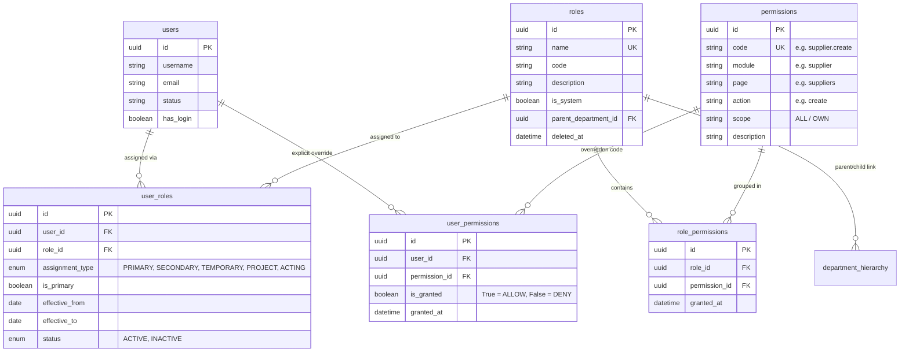

# Yinglima ERP — Roles, Permissions & Access Control Master Guide

## 1. Executive Summary & Architecture Overview

Yinglima ERP implements an enterprise-grade **Role-Based Access Control (RBAC)** engine tightly integrated with the company's real organizational structure (Departments and Hierarchies).

### Key Architectural Tenets:
1. **Department = Role Convergence:** An employee's organizational department (e.g. *Sales*, *Procurement*, *Logistics*) acts directly as their base permission bundle. Placing a user into a department automatically grants them the operational permissions defined for that department.
2. **Three-Tier Precedence Engine:**
   - **Super Admin (`super_admin`):** Full system override. Bypasses all individual permission checks (`__contains__` evaluates to `True`).
   - **Role / Department Level:** The union of permissions across all active roles and department assignments held by the user.
   - **User-Level Direct Overrides:** Explicit `ALLOW` (grant) or `DENY` (revoke) flags assigned directly to an individual user, taking absolute precedence over their role defaults.
3. **Decoupled Enforcement:** Permissions are never hardcoded in database table rows as raw text. They exist as seeded code constants, validated at runtime, embedded in JWT session tokens, cached in Redis/memory with real-time invalidation, and enforced at both FastAPI API endpoints and React UI component trees.

---

## 2. Mathematical Effective Permission Formula

The backend resolves a user's active capabilities using the following deterministic set formula:

$$\text{Effective Permissions} = \left( \bigcup_{r \in \text{ActiveRoles}(u)} \text{Permissions}(r) \cup \text{UserGrants}(u) \right) \setminus \text{UserDenies}(u)$$

### Active Assignment Window:
A role or department assignment is only active if:
1. `UserRole.status == ACTIVE`
2. `UserRole.effective_from <= TODAY` (or is null)
3. `UserRole.effective_to >= TODAY` (or is null)
4. `Role.deleted_at IS NULL` (soft-deleted roles do NOT grant permissions)

---

## 3. Database Schema & Data Models



---

## 4. Complete System Permission Matrix

Every action in Yinglima ERP maps to a standard `module.action` permission code.

### 4.1. Core Master Modules
| Module | Permission Code | Friendly Name | Description |
| :--- | :--- | :--- | :--- |
| **Suppliers** | `supplier.view` | View Suppliers | Access supplier list, search, and view profiles |
| | `supplier.create` | Create Supplier | Add new suppliers to the directory |
| | `supplier.update` | Edit Supplier | Modify supplier details, bank info, and contacts |
| | `supplier.delete` | Delete Supplier | Soft-delete a supplier record |
| | `suppliertype.view` | View Supplier Types | Access supplier type configuration |
| | `suppliertype.create` | Create Supplier Type | Add new supplier category/type classifications |
| | `suppliertype.update` | Edit Supplier Type | Rename or update supplier types |
| | `suppliertype.delete` | Delete Supplier Type | Remove supplier classifications |
| **Agents & Buyers** | `buyer.view` | View Buyers | View buyer profiles, contacts, and portfolios |
| | `buyer.create` | Create Buyer | Register new overseas buyers or agents |
| | `buyer.update` | Edit Buyer | Edit buyer addresses, contacts, and terms |
| | `buyer.delete` | Delete Buyer | Soft-delete a buyer record |
| | `buyer.currentstatus` | Edit Current Status | Update active / inactive prospecting status |
| | `buyer.potential` | Edit Potential | Update buyer volume / revenue potential rating |
| | `buyer.clientgrade` | Edit Client Grade | Modify VIP / Grade classification (A, B, C) |
| | `buyertype.view` | View Buyer Types | Access buyer classification types |
| **Products & Catalog**| `product.view` | View Products | Browse product master catalog and specs |
| | `product.create` | Create Product | Add new items, HSN, packing ratios |
| | `product.update` | Edit Product | Modify packaging specifications, weights, CBM |
| | `product.delete` | Delete Product | Soft-delete items from catalog |
| | `productgallery.view` | View Product Gallery | View high-resolution catalog photos and media |
| | `productgallery.create` | Upload Photos | Add product photography |
| | `product_price.view` | View Product Prices | Access confidential vendor quote histories |
| | `product_price.update` | Edit Product Prices | Update purchase and quotation prices |

### 4.2. Operational & Transactional Modules
| Module | Permission Code | Friendly Name | Description |
| :--- | :--- | :--- | :--- |
| **Inquiries & RFQ** | `inquiry.view` | View Inquiries | View buyer inquiries and quotation sheets |
| | `inquiry.create` | Create Inquiry | Log new buyer RFQs and build quotes |
| | `inquiry.update` | Edit Inquiry | Update specs, margins, costing sheets |
| | `inquiry.delete` | Delete Inquiry | Remove draft inquiries |
| | `inquiry.approve` | Approve Quotation | Manager sign-off for quotations |
| | `inquiry.send_message`| Send Inquiry Quotes | Dispatch formal quotes via Email / WeChat |
| **Shipment Planning** | `planning.view` | View Planning Sheet | Access Master Planning Sheet China to India |
| | `planning.create` | Add Planning Row | Create container shipment planning items |
| | `planning.update` | Edit Planning Sheet | Modify container numbers, ETD, ETA, quantities |
| | `planning.textyn.edit` | Edit TEST(Y/N) | Toggle lab test requirement flag |
| | `planning.approvaldate.edit` | Edit Approval Date | Modify official shipment release date |
| | `planning.colorstatusred.edit` | Set Status: Red | Mark shipment delayed / hold alert |
| | `planning.colorstatusgreen.edit`| Set Status: Green | Mark shipment approved / cleared |
| **Local Purchase** | `local_purchase.view` | View Local Purchases | Access local procurement order list |
| | `local_purchase.create` | Create Local Purchase | Enter purchase bills, items, and expenses |
| | `local_purchase.update` | Edit Local Purchase | Modify purchase orders, bills, and items |
| | `local_purchase.delete` | Delete Local Purchase | Cancel/delete a local purchase |
| | `local_purchase.export` | Export / Print Bill | Generate PDF / Excel purchase documentation |

### 4.3. Administration & Governance
| Module | Permission Code | Friendly Name | Description |
| :--- | :--- | :--- | :--- |
| **Departments & RBAC**| `roles_permissions.view` | View Roles & Perms | Browse departments, permission matrices |
| | `roles_permissions.create` | Create Department | Create new organizational units or roles |
| | `roles_permissions.action` | Manage Roles & Perms| Assign permissions, manage hierarchy, user overrides |
| **User Management** | `user.view` | View Users | View staff roster, employment details |
| | `user.create` | Create User | Provision employee accounts and logins |
| | `user.update` | Edit User | Edit profiles, status, department assignments |
| | `user.delete` | Deactivate User | Suspend, lock, or soft-delete user accounts |
| **Audit & Trash** | `audit.view` | View Audit Logs | Inspect immutable system activity history |
| | `trash.view` | View Trash Bin | Browse soft-deleted records across modules |
| | `trash.action` | Restore / Purge | Permanently purge or restore deleted items |

---

## 5. Backend Enforcement Mechanisms

### 5.1. Route Dependency: `require_permission(code)`
Every protected endpoint in FastAPI declares a dependency:
```python
from app.rbac.dependencies import require_permission

@router.post("", response_model=SupplierResponse)
async def create_supplier(
    payload: SupplierCreate,
    current_user: CurrentUser = Depends(require_permission("supplier.create")),
    service: SupplierService = Depends(get_supplier_service),
):
    return await service.create(payload, created_by=current_user.id)
```
If the user's `current_user.permissions` set does not contain `"supplier.create"` (and user is not `super_admin`), the request immediately aborts with `HTTP 403 Forbidden`.

### 5.2. Multi-Permission Dependency: `require_any_permission(*codes)`
For dynamic endpoints (e.g., editing cell values in the Master Planning Sheet):
```python
@router.patch("/planning/items/{id}/cell")
async def update_planning_cell(
    id: UUID,
    payload: CellUpdateRequest,
    current_user: CurrentUser = Depends(
        require_any_permission("planning.update", "planning.textyn.edit", "planning.approvaldate.edit")
    ),
):
    ...
```

### 5.3. Super Admin Dependency: `require_super_admin()`
Used for structural system operations (e.g. database purge, system reset):
```python
@router.delete("/system/hard-purge")
async def hard_purge(current_user: CurrentUser = Depends(require_super_admin())):
    ...
```

---

## 6. Frontend Enforcement & UI Guards

### 6.1. Declarative `<Can>` Component
Used in JSX templates to render buttons or sections only if authorized:
```tsx
import { Can } from "@/lib/auth";

<Can permission="local_purchase.create">
  <button onClick={handleCreate} className="btn-primary">
    + New Local Purchase
  </button>
</Can>
```

### 6.2. Imperative Check via `Auth.hasPermission()` or `useAuth()`
```tsx
import { useAuth } from "@/lib/auth";

export function SupplierPage() {
  const { hasPermission } = useAuth();
  const canEdit = hasPermission("supplier.update");
  const canDelete = hasPermission("supplier.delete");

  return (
    <div>
      {canEdit && <button onClick={openEditModal}>Edit</button>}
      {canDelete && <button onClick={handleDelete}>Delete</button>}
    </div>
  );
}
```

### 6.3. Route Navigation & Sidebar Filtering
In `src/lib/nav.ts`, sidebar links declare their required permission. Items for which the user lacks `*.view` or `*.read` are completely hidden from the navigation bar.

---

## 7. Real-Time Cache Invalidation Lifecycle

1. **User Logs In:** Backend resolves effective permissions, embeds them in the JWT token, and stores them in Redis/Cache key:
   `user_perms:{user_id}` (TTL: 3600 seconds).
2. **Administrator Updates Role or Overrides:**
   - Admin changes role permissions at `PUT /api/v1/rbac/roles/{id}/permissions`
   - OR admin assigns/removes a user from a department at `PUT /api/v1/rbac/users/{id}/permissions/bulk`
3. **Immediate Cache Eviction:**
   - The backend service immediately executes:
     ```python
     await self.cache.delete(f"user_perms:{user_id}")
     ```
   - On the user's very next API request, the dependency detects the cache miss, re-evaluates the mathematical formula from the DB, repopulates the cache, and applies the new permissions instantly without requiring the user to log out.

---

## 8. Managing Permissions via Admin UI

### How to configure via `/rbac` (Departments & Permissions):
1. **Department Selection:** Click on the department in the left sidebar (e.g. *Sales*, *China Operations*, *Accounts*).
2. **Permission Checkboxes:** The central matrix shows all 25 modules categorized by business domain.
3. **Toggle Capabilities:** Check or uncheck permissions (View, Create, Edit, Delete, Export, Approve).
4. **Save Role:** Click **Save Changes** — all members of that department inherit the update immediately.
5. **Individual Overrides (`Users` -> Row Action -> Permissions):**
   - If a specific employee in *Procurement* needs to approve quotations (an *Accounts* right), open their user override modal.
   - Check `inquiry.approve` as **ALLOW**.
   - If an intern in *Sales* should NOT delete buyers, check `buyer.delete` as **DENY**.
