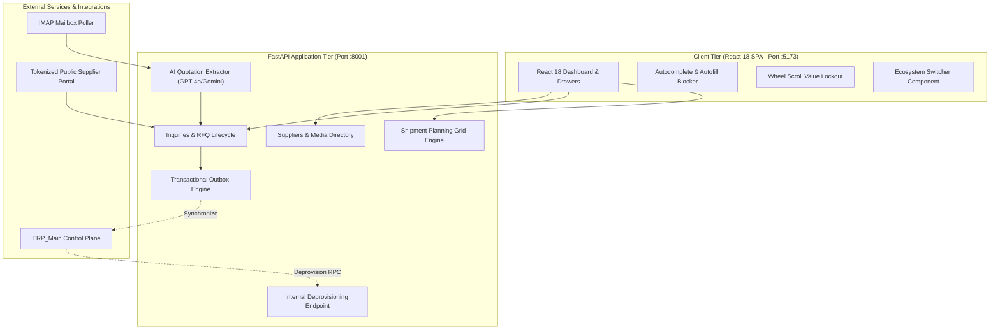
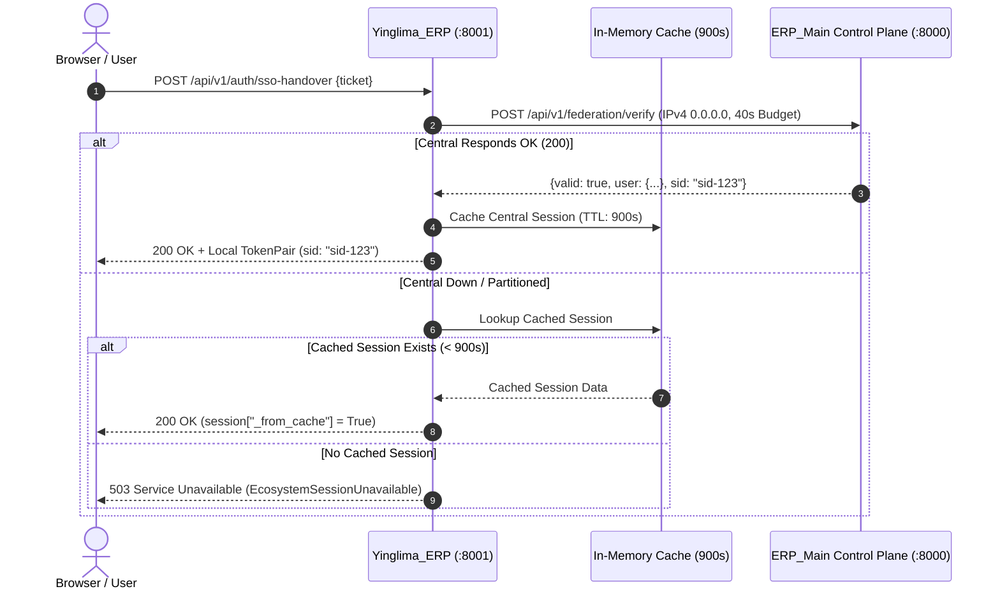
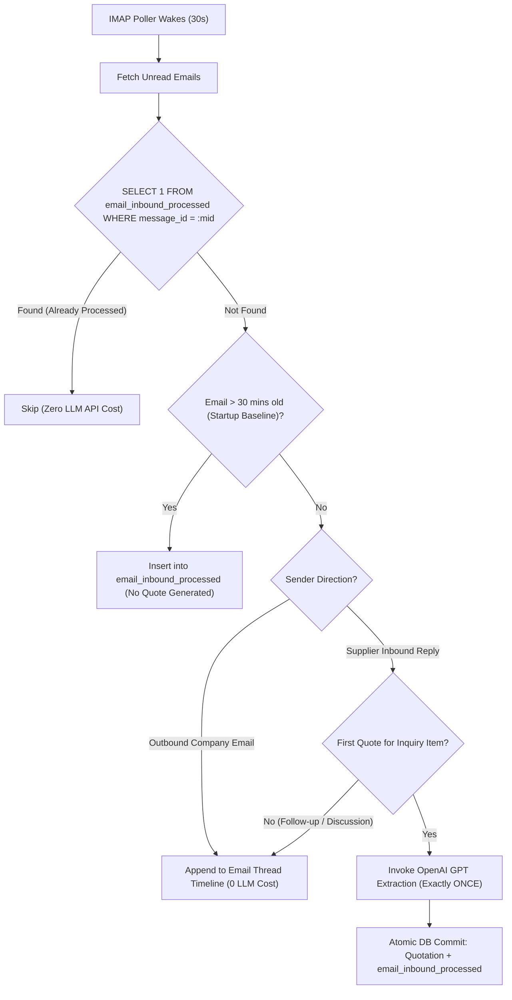

# Yinglima_ERP — System Architecture & Design Specification

**System Role:** China Sourcing, Procurement, Vendor Quotations & Master Shipment Planning  
**Architecture Type:** Modular Async Monolith (FastAPI) + React 18 SPA (Vite) + Outbox Engine  
**Database:** PostgreSQL (Supabase Cloud Pooler / Dedicated Database Schema)  
**Location:** `Yinglima_ERP/`

---

## 1. System Topology & Architectural Pattern

`Yinglima_ERP` powers China vendor procurement, automated quotation extraction, RFQ management, and container shipment planning.



---

## 2. Core Domain Architectures

### 2.1 Suppliers & Factory Media Directory
- Vendor catalog tracking Chinese suppliers, factory locations, English/Chinese names, WeChat/WhatsApp contacts, bank accounts, and tax numbers.
- Factory visit media persistent storage (photos, inspection videos) via Supabase Storage.

### 2.2 Inquiries, RFQs & AI Quotation Extractor
- Inbound IMAP email poller monitoring supplier responses to RFQs.
- **Zero Wasted API Calls:** First supplier reply triggers AI extraction; subsequent negotiation emails bypass AI and append directly to the email timeline.
- Dynamic quotation matrix comparing multi-vendor pricing, lead times, MOQ, and terms.
- Public tokenized submission portal for direct vendor quote input without ERP login.

### 2.3 Master Shipment Planning Grid Engine
- Dynamic spreadsheet-like planning grid for container optimization (20GP, 40GP, 40HQ, 45HQ).
- Automated CBM and gross weight calculations with status tagging per cell/row.

### 2.4 Transactional Outbox Engine
- Guaranteed event delivery to `ERP_Main` for global reporting and projections without two-phase commit overhead.

### 2.5 Commercial Invoice (CI) 16-Column Costing Engine & Local Purchase Sourcing
- **Confirmed Local Purchase Source of Truth:** Sourcing and purchase pricing for Sale Process orders automatically pull from the latest confirmed Local Purchase order for that product.
- **Dynamic VAT Exclusion & Export Costing:** Uses HSN Refund VAT rates (standard 13%) to dynamically compute `Unit Price Excl. VAT = Unit Price Incl. VAT / (1 + Refund VAT%)`, FOB Price (USD), container freight allocation per CBM, CFR unit prices, and supplier payables matching the official 16-column Excel export model.

### 2.6 Federated Authentication, Central Verification & Password Synchronization
- **Central Session Routing & Graceful Login:** Spoke login authenticates locally and simultaneously establishes an ecosystem session with `ERP_Main`. If a user is not authorized for Yinglima, they are redirected automatically to their assigned spoke or to the Central Control Plane. If a recent password change hasn't synced locally, the verified central session completes authentication via SSO handover.
- **Bi-Directional Password Synchronization:** Local password changes (`/auth/change-password` and `/users/{id}/reset-password`) are securely transmitted to `ERP_Main` via `POST /internal/users/password` using internal service credentials, fanning out updates across the ecosystem.
- **Fail-Closed Central Session Verification:** Inbound SSO handover logins verify the central session against ERP_Main's live database via `verify_ecosystem_session()`. Revoked or suspended accounts cannot bypass security checks.
- **Central Identity Protection:** User email addresses are locked to the central control plane (`enforce_central_identity`), preventing local edits from breaking global SSO mappings.

### 2.7 Multi-Identifier Spoke Recognition & Resilient SSO Switching
- **Multi-Identifier Spoke Resolution:** The SSO handover route (`/auth/sso-handover`) accepts any registered alias for the spoke (`{"yinglima", "erp-02", settings.ERP_KEY, settings.ERP_INSTANCE_ID}`). This eliminates cross-ERP switching failures when ERP_Main issues access grants under varying keys.
- **Super Administrator Omnipresence:** Users holding central `super_admin` or `platform_admin` roles are exempt from spoke restriction checks, guaranteeing unconditional administrative access across all nodes.
- **Watcher Polling Loop Protection:** Frontend session watcher (`ecosystemSession.ts`) distinguishes between an unauthenticated state (`notFound: true`) and an active revocation (`revoked: true`). Unauthenticated states retain local sessions and do not trigger infinite reload loops.
- **SSO Switching Fallbacks:** `ssoBridge.ts` passes the caller's target path (`/login?sso_handover=...`) and gracefully falls back to direct navigation if the destination already holds a valid local session.

---

## 3. Frontend Architecture & Platform Hardening

### 3.1 Global Autocomplete & Autofill Blocker (`lib/autocompleteBlocker.ts`)
- Continuously enforces `autocomplete="off"`, `autocapitalize="off"`, `spellcheck="false"`, `data-lpignore="true"` (LastPass blocker), and `data-form-type="other"` (heuristics disabler) across all DOM elements via a `MutationObserver`.
- Capture-phase `focusin` listener intercepts user interactions before browser suggestion popups render, permanently suppressing floating suggestion bubbles.

### 3.2 Wheel Scroll Value Lockout & Spin-Button Elimination
- Document-level passive `wheel` listener blurs `input[type="number"]` elements on mouse wheel scroll.
- Universal CSS removes webkit outer/inner spin buttons and sets `-moz-appearance: textfield`.

### 3.3 SSO Handover & Identity Preservation
- `ssoBridge.ts` passes the active authenticated user's email and first name during ERP switching, preventing unintended admin fallback.

### 3.4 Cascading Category Hierarchy Enforcement
- In `Products.tsx`, `Suppliers.tsx`, `Buyers.tsx`, and `SearchableDropdown.tsx`, subcategory options are strictly locked until a primary category is selected. Changing or clearing a category automatically resets linked subcategories.

---

## 4. Directory Layout

```
Yinglima_ERP/
├── backend/
│   ├── app/
│   │   ├── suppliers/            # Supplier directory & visit media
│   │   ├── inquiries/            # Inquiries, RFQs, quotation comparison
│   │   ├── planning/             # Container shipment planning sheets
│   │   ├── email_poller/         # IMAP inbound quote poller
│   │   ├── quotation_extractor/  # AI extraction pipeline (OpenAI/Gemini)
│   │   ├── outbox/               # Transactional outbox publisher
│   │   └── api/v1/internal_users.py # Spoke user deprovisioning endpoint
│   ├── alembic/                  # Database migrations
│   └── tests/                    # Backend test suites
├── frontend/
│   ├── src/
│   │   ├── components/           # EcosystemSwitcher, UI tokens
│   │   ├── lib/                  # autocompleteBlocker.ts, ssoBridge.ts
│   │   ├── pages/                # Suppliers, Inquiries, PlanningSheets
│   │   ├── App.tsx               # App lifecycle & blocker initialization
│   │   └── main.tsx              # Wheel scroll lockout listener
│   └── package.json
└── doc/                          # System documentation
```

---

## 5. Machine Identifiers vs. Dynamic Human Branding

To achieve complete decoupling between infrastructure routing and organizational branding:

1. **Unique Machine Identifier (`erp-02`):**
   - The backend instance identifier `ERP_INSTANCE_ID = "erp-02"` is defined in [`backend/app/core/config.py`](file:///c:/Users/Inhyma%20Solutions/OneDrive/Desktop/ERP/Yinglima_ERP/backend/app/core/config.py).
   - Used for inter-ERP service-to-service authentication, health reporting, and identity sync across the ecosystem.

2. **Public Branding Contract (`GET /organizations/public`):**
   - Unauthenticated endpoint serving `{ company_name, legal_name, logo_url, erp_id }`.
   - Allows client applications, login pages, and browser tab titles to resolve branding dynamically before authentication.

3. **Dynamic Single Source of Truth (`ERP Settings -> Company Name`):**
   - The human-facing brand name is never hardcoded in source files.
   - All frontend components, public supplier quotation pages, and sales order forms query `getCachedBrandName()`, which stays synchronized with the active record in the `organizations` database table.

---

## 6. Database Connection Resilience & Production Security

1. **PgBouncer / Supabase Transaction Pooler Statement Cache Auto-Disable:**
   - In `app/database/engine.py`, `_statement_cache_must_be_disabled()` automatically detects port 6543 / PgBouncer and sets `statement_cache_size=0` on asyncpg, preventing PostgreSQL `DuplicatePreparedStatementError`.
2. **Production HTTPS Origin Protection & Mixed Content Elimination:**
   - In `ecosystemSession.ts` and `ssoBridge.ts`, `isLocalhost()` guards prevent fallback to insecure `http://localhost:*` URLs when served on HTTPS domains (Render, custom domains).

---

## 7. Central Ecosystem Federation & Spoke Resilience

In a multi-ERP topology where `ERP_Main` serves as the central identity authority and control plane, `Yinglima_ERP` operates as a resilient spoke capable of surviving upstream cloud cold-starts and transient network partitions.



### 7.1. Architectural Safeguards
1. **Multi-URL Base Candidate Discovery (`erp_main_api_base_urls()`):**
   - Automatically probes `ERP_MAIN_API_BASE_URL`, `ERP_MAIN_URL`, and fallback platform URLs.
2. **IPv4 Outbound Socket Binding (`local_address="0.0.0.0"`):**
   - Forces IPv4 socket binding in all `httpx.AsyncClient` federation connections to prevent broken IPv6 routing in cloud containers.
3. **40-Second Cold-Start Sleeping Budget:**
   - Cloud container hibernation wake-up allowance (`httpx.Timeout(40.0, connect=20.0)`).
4. **900-Second Stale Session Cache Fallback:**
   - Spoke instances maintain local memory cache for verified central sessions up to 15 minutes, maintaining operational continuity during control plane maintenance.
5. **Platform-Gated Winsock DNS Isolation:**
   - In `backend/app/core/dns_resilience.py`, asynchronous DNS caching is platform-gated to Windows developer machines (`sys.platform.startswith("win")`), preventing Winsock exhaustion without affecting production Linux glibc resolvers.
   - Caches 5-tuple `(host, port, family, type, proto)`, preserving distinct port mappings for local developer testing.

---

## 8. Inbound Email Processing & Atomic Database Deduplication



- **Table `email_inbound_processed`:** Compound uniqueness on `(message_id, uid, inquiry_id, supplier_id)` prevents race conditions and redundant extraction across restarts.
- **Cost Discipline:** Quotations extract exactly once (`QT-AUTO-01`); subsequent negotiation emails bypass AI completely.

---

## 9. Idempotent Deployment & First-Install Seed Protection

Automated container deployment platforms (Render, Docker, Kubernetes) execute build and pre-deploy scripts sequentially.

1. **Bootstrap Force Reset Guard (`BOOTSTRAP_FORCE_RESET`):**
   - In `backend/scripts/seed.py`, existing user, organization, or role data halts seeding automatically.
   - Live production records are never overwritten unless `BOOTSTRAP_FORCE_RESET=true` is explicitly provided.
2. **Geography & Master Data Protection:**
   - Verifies existing records in `countries`, `states`, `districts`, and `cities` before inserting defaults.
3. **SSO Handover Deactivated Account Rejection:**
   - In `backend/app/api/v1/auth.py`, incoming federated SSO requests for users with `is_active=False` or `deleted_at IS NOT NULL` are rejected with `401 Unauthorized` ("Account is inactive or disabled on this ERP instance").
   - Respects `SSO_HANDOVER_AUTO_PROVISION=false` to block unauthorized account creation.

---

## 10. Database-Backed Organization Branding & Storage Quota Protection

1. **Database Persistence & Public Binary Streaming:**
   - Organization logo image binary is persisted directly in PostgreSQL (`organizations.logo_data`).
   - Served via `GET /api/v1/organizations/logo?v={sha1}` with `Cache-Control: public, max-age=86400, immutable`.
   - Content hash `?v={sha1}` forces instant cache invalidation upon logo replacement.
2. **Client Quota Protection:**
   - `try/catch` wrappers around `localStorage.setItem` in `brand.ts` and `Organization.tsx` eliminate browser `QuotaExceededError` crashes on mobile devices when storing high-resolution image strings.


