# Yinglima ERP — Complete System Workflow, Architecture & Module Guide

> **Document Type:** Executive Architecture, System Workflow & User Interface Manual  
> **Prepared For:** Executive Management, Operations Leadership, and QA & Development Teams  
> **System:** **Yinglima ERP** (China Global Procurement & Export Trade Engine)  
> **Location:** `/doc/YINGLIMA_ERP_COMPLETE_WORKFLOW_AND_SYSTEM_GUIDE.md`  
> **Version:** 2.4.0 (Enterprise Edition)  
> **Status:** Production Reference  

---

## Table of Contents

1. [Master End-to-End System Flow Diagrams](#1-master-end-to-end-system-flow-diagrams)
   - 1.1. [High-Level Business Lifecycle Flow](#11-high-level-business-lifecycle-flow)
   - 1.2. [Cross-Border Commercial & Financial Lifecycle](#12-cross-border-commercial--financial-lifecycle)
   - 1.3. [System Relational & Data Transfer Architecture](#13-system-relational--data-transfer-architecture)
2. [Executive System Overview & Core Philosophy](#2-executive-system-overview--core-philosophy)
3. [Module-by-Module Comprehensive Workflows & Screen Guide](#3-module-by-module-comprehensive-workflows--screen-guide)
   - 3.1. [DASHBOARD Module (`/dashboard`)](#31-dashboard-module-dashboard)
   - 3.2. [CONTACT: Suppliers Master Module (`/suppliers`)](#32-contact-suppliers-master-module-suppliers)
   - 3.3. [CONTACT: Buyers Master Module (`/buyers`)](#33-contact-buyers-master-module-buyers)
   - 3.4. [INVENTORY: Product Master & Gallery (`/masters/products`, `/inventory/product-gallery`)](#34-inventory-product-master--gallery-mastersproducts-inventoryproduct-gallery)
   - 3.5. [INVENTORY: Product Prices & Quotation Matrix (`/inventory/product-prices`)](#35-inventory-product-prices--quotation-matrix-inventoryproduct-prices)
   - 3.6. [INVENTORY: Stock Movement & Live Inventory Ledger (`/inventory/stock-movement`)](#36-inventory-stock-movement--live-inventory-ledger-inventorystock-movement)
   - 3.7. [SALE: Inquiries & RFQ Lifecycle Engine (`/inquiries`)](#37-sale-inquiries--rfq-lifecycle-engine-inquiries)
   - 3.8. [PURCHASE: Local Purchase Module (`/purchases/local`)](#38-purchase-local-purchase-module-purchaseslocal)
   - 3.9. [PLANNING: Master Shipment Planning Grid (`/planning`)](#39-planning-master-shipment-planning-grid-planning)
   - 3.10. [SALE: Sale Process & Official Export Trade Engine (`/sale/process`)](#310-sale-sale-process--official-export-trade-engine-saleprocess)
   - 3.11. [CONFIGURATIONS: System Masters (HSN, Geography, Currency, UOM, Organizations)](#311-configurations-system-masters-hsn-geography-currency-uom-organizations)
   - 3.12. [USER MANAGEMENT: Users & RBAC Permissions (`/users`, `/roles`)](#312-user-management-users--rbac-permissions-users-roles)
   - 3.13. [GOVERNANCE: Audit Log & Recycle Bin (`/settings/audit-log`, `/settings/trash`)](#313-governance-audit-log--recycle-bin-settingsaudit-log-settingstrash)
   - 3.14. [CROSS-ERP: Automated Synchronization Engine (Yinglima &rarr; Inhyma)](#314-cross-erp-automated-synchronization-engine-yinglima--inhyma)
4. [Step-by-Step Operational Cheatsheet for Daily Business Execution](#4-step-by-step-operational-cheatsheet-for-daily-business-execution)

---

# 1. Master End-to-End System Flow Diagrams

### 1.1. High-Level Business Lifecycle Flow

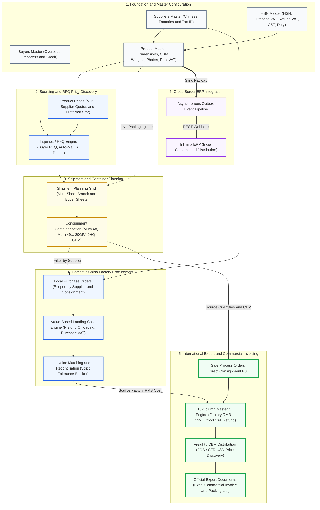

---

### 1.2. Cross-Border Commercial & Financial Lifecycle

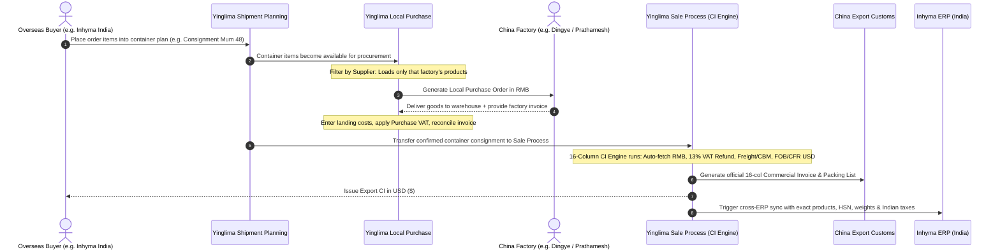

---

### 1.3. System Relational & Data Transfer Architecture

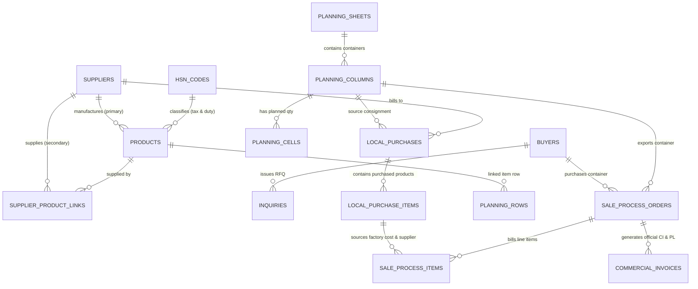

---

# 2. Executive System Overview & Core Philosophy

**Yinglima ERP** is purpose-built to orchestrate high-volume international sourcing, domestic procurement within Mainland China, complex multi-vendor container consolidation, and official export trade documentation.

### Core Architectural Pillars:

1. **Dual-Currency Accounting:**
   - **Domestic Operations (RMB `¥`):** Sourcing quotes, factory local purchases, inland logistics, local offloading, and domestic purchase VAT (进项税).
   - **International Export Operations (USD `$`):** Overseas sales pricing, ocean freight allocations, export VAT refunds (出口退税), and official Commercial Invoices.
2. **Three-Tier Multi-Tax Engine:**
   - **China Purchase VAT % (进项税):** Domestic VAT (0%, 9%, 13%) incurred on domestic Chinese factory purchases.
   - **China Export Refund VAT % (出口退税):** Rebate claimed back from the Chinese government upon export (e.g. 13% for machinery).
   - **Indian GST % & Import Duty %:** Downstream destination taxation passed dynamically to overseas subsidiaries (e.g. Inhyma India).
3. **Consignment Multi-Vendor Container Consolidation:**
   - A single 40HQ container (e.g. `Mum 48`) holds cargo from 10+ distinct factories. The system provides complete multi-vendor isolation so that local purchase orders and factory invoices never cross-contaminate unrelated suppliers.
4. **Strict Financial Reconciliations & Quality Gates:**
   - Local Purchase features a mathematical $\Delta \le 0.05$ discrepancy blocker between invoice header and calculated line items.
   - Zero-rate product lines are strictly prevented from saving to eliminate missing costs in downstream commercial invoices.

---

# 3. Module-by-Module Comprehensive Workflows & Screen Guide

---

## 3.1. DASHBOARD Module (`/dashboard`)

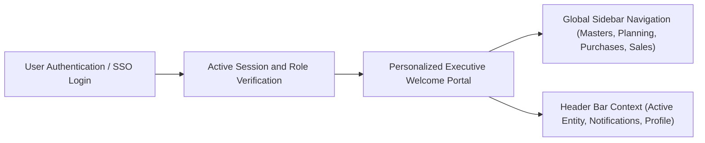

### Business Purpose & What is Happening:
The Dashboard (`/dashboard`) serves as the central landing page and secure authenticated portal gateway for Yinglima ERP.
- **Clean Gateway Architecture:** In Yinglima ERP, the dashboard is designed as a focused, distraction-free landing portal. Rather than displaying cluttered or decoupled KPI cards on the root page, **all primary operational KPIs, tracking metrics, and financial registers are embedded directly inside their respective dedicated functional modules** where decisions occur in real-time context:
  - **Sourcing & RFQ Statuses:** Tracked inside **Inquiries (`/inquiries`)** (Dedicated status cards for *Pending RFQs*, *Approved Quotes*, *Ongoing Inquiries*, and *Completed Consignments*).
  - **Container Capacity & Volume Tracking:** Tracked live inside **Shipment Planning (`/planning`)** (Real-time container CBM rollups against 20GP/40HQ limits, package counts, and weights).
  - **Procurement Balances & Financial Reconciliations:** Audited on-the-fly inside **Local Purchase (`/purchases/local`)** (Live invoice-to-item discrepancy matching and landing cost distributions).
  - **Trade Margins & Commercial Export Values:** Computed dynamically inside **Sale Process (`/sale/process`)** (16-Column export CIF/FOB summary, profit margins, and export VAT refunds).

### Visual Appearance & User Interface:
- **Personalized Header:** A clean, modern greeting: `"Welcome To {Full Name}"` (e.g. `Welcome To Rupesh Malla` or current logged-in user name).
- **Navigation Shell (`AppShell`):**
  - Left navigation drawer providing instant 1-click access to all operational modules (Suppliers, Buyers, Product Master, Product Prices, Product Gallery, Stock Movement, Sale Process, Inquiries, Local Purchase, Shipment Planning, Users, and Settings).
  - Top system bar featuring the active corporate entity selector (`🏢 Yinglima LLP`), notification alert bell, and user account dropdown.

---

## 3.2. CONTACT: Suppliers Master Module (`/suppliers`)

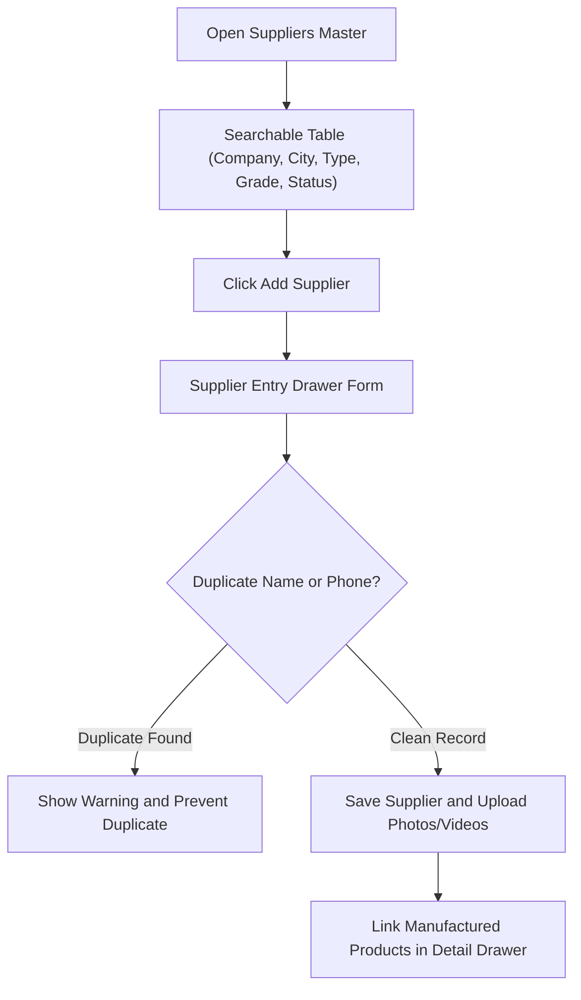

### Business Purpose & What is Happening:
Maintains the master repository of all verified Chinese manufacturing plants, trading companies, and logistics agents. Stores critical operational data such as factory locations, WeChat contacts, China Unified Social Credit Codes (USCC), factory audit photos, and product linkages.

### Visual Appearance & User Interface:
- **Supplier Directory Table:**
  - Columns: *Sr No*, *Company Name (Bold)*, *Supplier Type (Badge)*, *Location (Province & City)*, *Grade (A/B/C)*, *Status (New/Existing)*, *Product Count*, and *Actions*.
  - Color-coded badges: Green for Grade A, Blue for Grade B, Amber for Grade C.
- **Supplier Entry Form (Modal/Drawer):**
  - *Company Information:* Company Name, Type (Manufacturer/Trader/Agent), China Tax USCC (18 digits).
  - *Geographic Selectors:* Dynamic cascading dropdowns (Country &rarr; Province &rarr; City &rarr; District).
  - *Communication:* Contact Person, Mobile, Email, and WeChat ID (vital for Chinese factory communication).
  - *Factory Verification Media:* Multi-file upload for factory visit photos (audits, machine floors) and embedded video link badges (YouTube, Google Drive, OneDrive).
- **Secondary Product Links:** A dedicated tab inside the Supplier Detail drawer allows linking secondary products this vendor can supply.

---

## 3.3. CONTACT: Buyers Master Module (`/buyers`)

### Business Purpose & What is Happening:
Manages domestic and international buyer accounts, their designated destination delivery ports (e.g. Nhava Sheva, Chennai), agreed credit terms, default billing currencies, and dedicated shipment planning sheets.

### Visual Appearance & User Interface:
- **Buyer Directory:** Cards and table view displaying buyer company name, country, primary contact, payment credit terms (e.g. *30% Advance, 70% against BL*), and active consignment counts.
- **Detail Drawer:** Tabs for *Overview*, *Associated Consignments*, *Inquiries*, and *Commercial Invoices History*.

---

## 3.4. INVENTORY: Product Master & Gallery (`/masters/products`, `/inventory/product-gallery`)

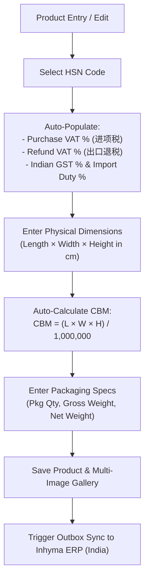

### Business Purpose & What is Happening:
The central source of truth for all physical products, machinery, spare parts, and packaging materials. Every line item planned in containers, purchased from factories, or exported on commercial invoices references this master record.

### Visual Appearance & User Interface:
- **Product Directory Table:**
  - Thumbnail preview, Product Name, Product Code (`PROD-MUM-xxxx`), Brand, Category & Subcategory, HSN Code, Packaging Qty, Unit CBM, Gross Weight, Purchase VAT %, and Status (Active/Inactive).
- **Executive Detail Drawer (Right Side):**
  - *Identity Badge:* High-contrast code badge with active/inactive status pill.
  - *Image Viewer:* Multi-image carousel with zoom modal.
  - *Operating Locations:* Assigned organizations (e.g. Inhyma, Darsh Impex) and operating branches (Mumbai, Ahmedabad, Chennai, Indore).
  - *Packaging & Dimensions Grid:* Auto-computed CBM highlighted in bold blue (`XX.XXXXXX CBM`).
  - *Classification, Sourcing & Tax:* Primary Supplier Brand, HSN Code, GST Rate (18%), Domestic Purchase VAT % (0%/13%), and Export Refund VAT % (13%).
- **Product Gallery (`/inventory/product-gallery`):** A visual grid displaying high-resolution machinery pictures with instant search by name, model, or barcode.

---

## 3.5. INVENTORY: Product Prices & Quotation Matrix (`/inventory/product-prices`)

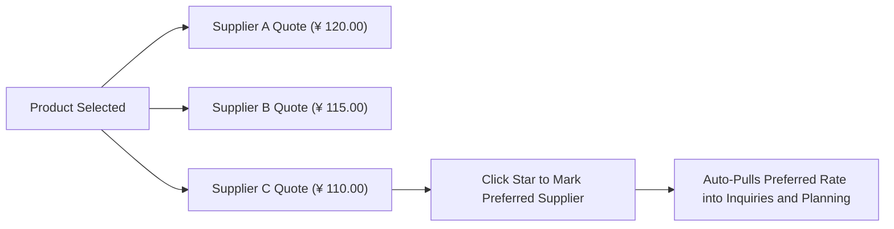

### Business Purpose & What is Happening:
Enables procurement teams to track competing quotations from multiple factories for the exact same product. Allows designating a **Preferred Supplier (`⭐`)** whose pricing automatically acts as the benchmark quote in inquiries and purchase orders.

### Visual Appearance & User Interface:
- **Price Matrix Table:** Product name on the left, followed by columns for each quoting supplier, unit price in RMB (`¥`), minimum order quantity (MOQ), lead time (days), and validity date.
- **Preferred Star Button:** Instant click-to-toggle star (`⭐`) that sets the default sourcing partner.

---

## 3.6. INVENTORY: Stock Movement & Live Inventory Ledger (`/inventory/stock-movement`)

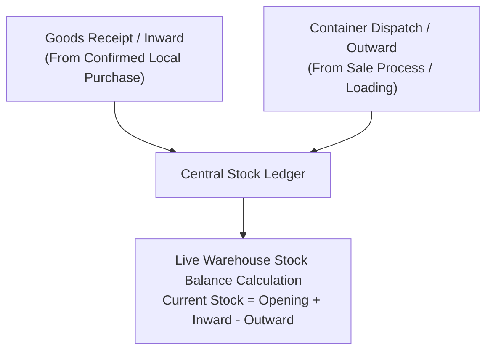

### Business Purpose & What is Happening:
Maintains real-time stock balances across China transit warehouses. Automatically increments inventory when domestic factory local purchases are received, and decrements inventory when container shipments depart.

### Visual Appearance & User Interface:
- **Tabbed Register:** Tabs for `Live Stock Summary`, `Inward Register (+Receipts)`, and `Outward Register (-Shipments)`.
- **Filters:** Quick filtering by Warehouse Location, Product Category, and Date Range.

---

## 3.7. SALE: Inquiries & RFQ Lifecycle Engine (`/inquiries`)

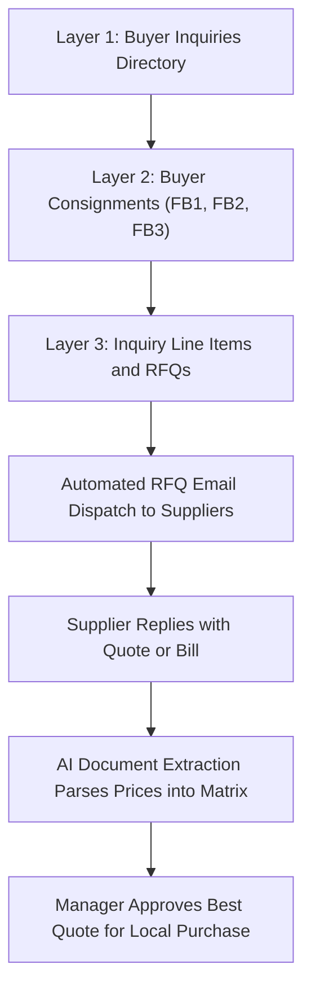

### Business Purpose & What is Happening:
Manages customer requests for quotation (RFQs) through a synchronized 3-layer architecture. Connects client specifications to multiple Chinese factory RFQs, auto-dispatches emails, and ingests supplier quotation sheets using AI document parsing.

### Visual Appearance & User Interface:
- **Layer 1 Directory:** High-level summary cards showing count of Pending RFQs, Approved Quotes, Ongoing Inquiries, and Completed Consignments.
- **Layer 2 Consignments:** Grouped consignments for each buyer (e.g. *FB1 Inquiry for Inhyma*).
- **Layer 3 RFQ Matrix:** Detailed line items listing requested quantity, target price, factory responses, and supplier quote comparisons.
- **AI Mailbox Ingestion:** Drag-and-drop zone for PDF/Excel supplier quotation bills with instant data extraction into table rows.

---

## 3.8. PURCHASE: Local Purchase Module (`/purchases/local`)

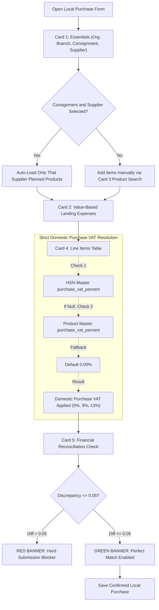

### Business Purpose & What is Happening:
The domestic Chinese procurement hub. Generates factory purchase orders in RMB (`¥`), records official Chinese supplier tax invoices, apportions inland transportation and offloading expenses, and applies domestic Chinese Purchase VAT (进项税).

### Visual Appearance & User Interface:
1. **Card 1: Procurement & Invoice Essentials:**
   - Dropdowns for *Organization* (e.g. Inhyma), *Operating Branch* (e.g. Inhyma Mumbai INM), *Consignment* (e.g. `Mum 48`), and *Supplier* (e.g. `Prathamesh Packaging PVT LTD`).
   - *Invoice No*, *Invoice Date*, *Billing Currency* (RMB `¥`), and *Invoice Total Value*.
   - *Supplier-Scoped Consignment Filtering Banner:* Live pill showing: `📦 {N} planned item(s) for {supplier} from Consignment {code}`.
2. **Card 2: Value-Based (VB) Landing Expense Engine:**
   - Four distinct input boxes: `Packaging Charges`, `Transport / Freight`, `Offloading Charges`, and `Other Misc Charges`.
   - Live summary showing total landing expenses and percentage loading ratio.
3. **Card 3: Product Search Bar:**
   - Fast autocomplete search allowing manual addition of products scoped to the selected organization.
4. **Card 4: Consignment Line Items Table:**
   - Columns: `#`, `Product Name (Bold with code pill)`, `HSN Code`, `Qty`, `Unit Rate (RMB)`, `VAT % (Domestic Purchase VAT)`, `Item Total`, `Expense Per Unit`, `Unit Landing Rate (VB)`, and `Total Landing Rate (VB)`.
   - **Zero Rate Guard:** Cells with `Rate = 0` display a red border and `▲ Rate > 0 req.` blocker label.
5. **Card 5: Smart Financial Reconciliation Banner:**
   - **Green Banner:** `✅ Invoice Total Matches Line Items Perfectly` (discrepancy $\le 0.05$).
   - **Red Blocker Banner:** `⛔ Discrepancy Detected: Entered invoice total differs from items total with VAT by [diff]. Adjust line items or invoice total to match before submitting.`
6. **Card 6: Document Attachment & Bill Extraction:**
   - Upload invoice PDF, image, or Excel file with download preview.

---

## 3.9. PLANNING: Master Shipment Planning Grid (`/planning`)

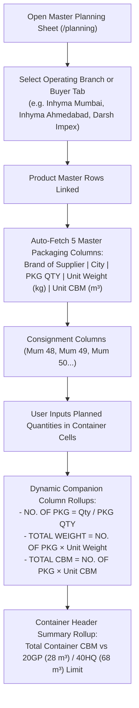

### Business Purpose & What is Happening:
Replicates and digitizes the enterprise Excel *Master Planning Sheet China TO India*. Provides an interactive, reactive spreadsheet grid tracking full-container load (FCL) and less-than-container load (LCL) shipments, container numbers, seal numbers, vessels, ETD, ETA, port of discharge, lab test requirements, cargo readiness, and real-time container volume (CBM) utilization.

### Visual Appearance & User Interface:
- **Multi-Sheet Navigation Tabs:**
  - Branch Tabs: `Inhyma Mumbai`, `Inhyma Ahmedabad`, `Inhyma Indore`, `Inhyma Chennai`, `Darsh Impex Mumbai`, `Darsh Impex Chennai`, `Test Group`, `One Stop`, `F&B`.
  - Buyer Tabs: `Om Packaging`, `Prathamesh Packaging`, `Darsh Impex Mumbai`.
- **Spreadsheet Grid Columns:**
  - *Fixed Headers:* `ITEM (Product Name)`, `TALLY ENTRY POSTED`, `APPROVAL DATE`.
  - *Dynamic Consignment Sets:* Columns grouped by container (e.g. `MUM 48`, `MUM 48 REMARKS`, `MUM 49`, `MUM 49 REMARKS`).
  - *Automated Master Specifications:* `BRAND OF SUPPLIER`, `CITY`, `PKG QTY`, `UNIT WEIGHT/PKG (KG)`, `CBM/PKG (M3)`.
  - *Companion Rollups:* `NO OF PKG`, `TOTAL WEIGHT (KG)`, `TOTAL CBM (M3)`.
- **Live CBM Utilization Progress Bars:** Visual container capacity indicators showing current load vs max container volume (e.g. 65.4 / 68.0 CBM for 40HQ).

---

## 3.10. SALE: Sale Process & Official Export Trade Engine (`/sale/process`)

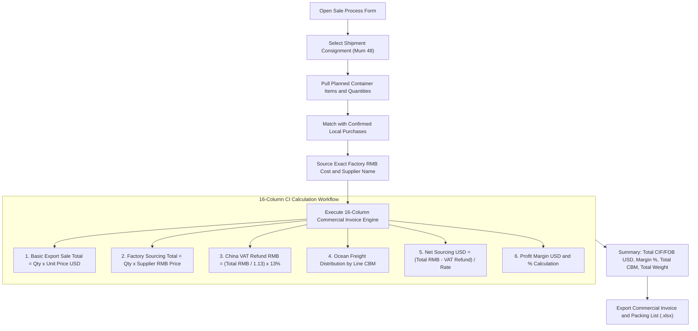

### Business Purpose & What is Happening:
The international trade and billing engine. Connects confirmed buyer orders, confirmed supplier local purchases, container shipping allocations, export VAT refunds, and Commercial Invoice (CI) 16-column calculations. Generates official trade documents required by shipping lines and customs authorities.

### Visual Appearance & User Interface:
- **Order Header Section:**
  - Buyer selection, Consignment dropdown (`Mum 48`), Currency (USD `$`), USD/RMB Exchange Rate (e.g. `7.25`), Destination Port (e.g. Nhava Sheva, India), Container No, and Seal No.
- **The 16-Column Master CI Grid:**
  1. `S/N`: Sequence index.
  2. `Product Description`: Product name and technical specifications.
  3. `HSN Code`: 8-digit international tariff code.
  4. `Quantity`: Order quantity.
  5. `Unit Price (USD)`: Export sale price per unit.
  6. `Total Amount (USD)`: `Quantity × Unit Price (USD)`.
  7. `Supplier Sourcing (RMB)`: Factory purchase rate auto-sourced from Local Purchase.
  8. `Total Purchase (RMB)`: Total factory cost.
  9. `VAT Refund Rate (%)`: China export tax rebate (13%).
  10. `VAT Refund Amount (RMB)`: Refund claimed back from China tax authorities.
  11. `Exchange Rate`: Applied currency conversion factor.
  12. `Gross Sourcing Cost (USD)`: Factory cost in USD.
  13. `Net Sourcing Cost (USD)`: Factory cost net of Chinese VAT refund.
  14. `Freight Allocation (USD)`: Container ocean freight allocated by CBM volume.
  15. `Profit Margin (USD)`: Net trade profit.
  16. `Profit Margin (%)`: Net margin percentage.
- **Export Action Bar:**
  - `📊 Export Commercial Invoice (Excel)`: Generates corporate `.xlsx` with official headers, seal boxes, bank wire instructions, and totals.
  - `📄 Export Packing List (Excel)`: Generates shipping packing list itemizing carton numbers, gross weights, net weights, and CBMs.

---

## 3.11. CONFIGURATIONS: System Masters (HSN, Geography, Currency, UOM, Organizations)

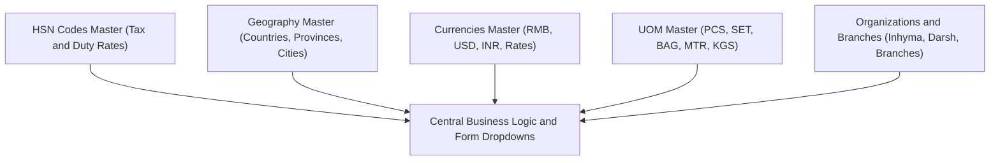

### Business Purpose & What is Happening:
Provides standardized configuration across all operational forms:
- **HSN Codes Master (`/masters/hsn`):** Maintains tariff codes with 4 simultaneous tax rates: *China Domestic Purchase VAT %*, *China Export Refund VAT %*, *Indian GST %*, and *Indian Import Duty %*.
- **Geography Masters (`/masters/countries`, `/masters/states`, `/masters/cities`):** Cascading location hierarchy for Chinese factories and overseas buyers.
- **Currencies Master (`/masters/currencies`):** Maintains standard exchange rates (USD &rarr; RMB, USD &rarr; INR).
- **Units of Measurement (`/masters/uom`):** Defines standard units (PCS, SET, BAG, BOX, MTR, KGS, ROLL).
- **Organization & Operating Branches (`/masters/companies`):** Multi-tenant scoping for company entities (Inhyma, Darsh Impex) and their branches (Mumbai, Ahmedabad, Indore, Chennai).

---

## 3.12. USER MANAGEMENT: Users & RBAC Permissions (`/users`, `/roles`)

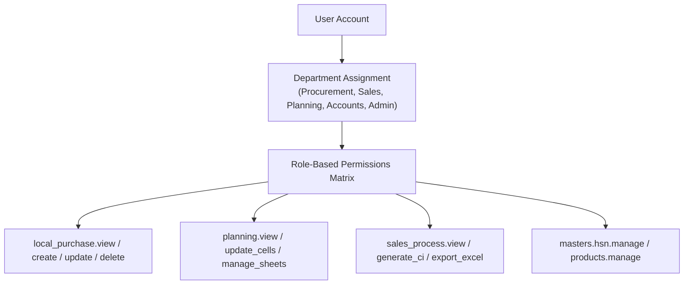

### Business Purpose & What is Happening:
Enforces enterprise security through granular, action-level Role-Based Access Control (RBAC). Restricts sensitive business actions (e.g. modifying purchase prices, approving shipments, exporting invoices, or deleting records) to authorized personnel.

### Visual Appearance & User Interface:
- **Users Directory:** Table of staff members, avatars, assigned department, role pills, status toggles, and last login timestamps.
- **Permissions Matrix Grid:** Accordion checkboxes granting view, create, edit, delete, export, or audit capabilities across all modules.

---

## 3.13. GOVERNANCE: Audit Log & Recycle Bin (`/settings/audit-log`, `/settings/trash`)

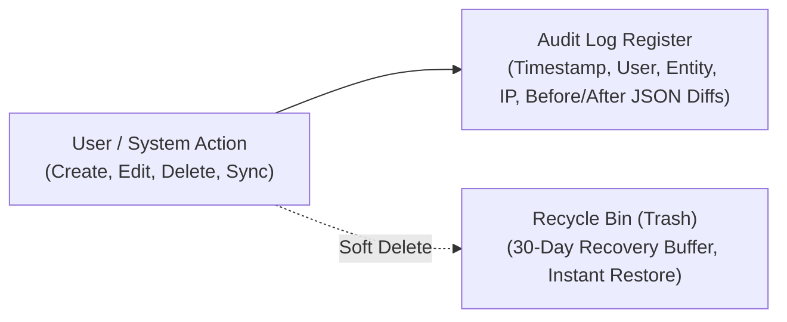

### Business Purpose & What is Happening:
- **Audit Log (`/settings/audit-log`):** Immutable compliance trail logging every write action, field-level before/after JSON diffs, acting user ID, and IP address.
- **Trash & Recovery (`/settings/trash`):** Soft-delete safety net (`deleted_at IS NOT NULL`). Allows immediate 1-click restoration of accidentally deleted suppliers, products, purchase orders, or planning rows.

---

## 3.14. CROSS-ERP: Automated Synchronization Engine (Yinglima &rarr; Inhyma)

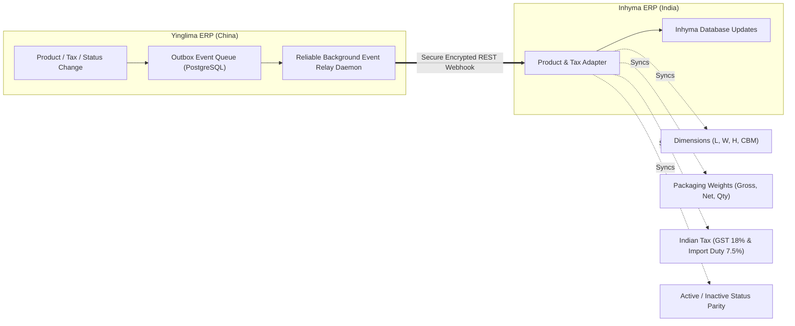

### Business Purpose & What is Happening:
Whenever a product, packaging dimension, HSN tariff code, or status is modified in Yinglima (China), the automated event relay immediately broadcasts the update to Inhyma ERP (India). This guarantees that Indian customs clearance, warehouse receiving, and local GST billing reflect the exact physical specifications and tax rates without manual double-entry.

---

# 4. Step-by-Step Operational Cheatsheet for Daily Business Execution

Follow this chronological checklist to execute an end-to-end container shipment from initial inquiry to export clearance:

| Step | Module | User Action | Verification & Expected Outcome |
| :---: | :--- | :--- | :--- |
| **1** | **Suppliers** | Register Chinese factory (e.g. `Prathamesh Packaging PVT LTD`) | Verified with China USCC Tax ID, province, city, and WeChat contact. |
| **2** | **HSN Master** | Create/Verify HSN Code (e.g. `8422.a247`) | Set China Purchase VAT (0%), Export Refund VAT (13%), Indian GST (18%), and Duty (7.5%). |
| **3** | **Product Master** | Create Product (e.g. `PROD-MUM-0002` Carton Boxes) | Link to Supplier, assign HSN, enter L×W×H dimensions (auto-computes CBM), and upload photo. |
| **4** | **Shipment Planning** | Open Branch Sheet (e.g. `Inhyma Mumbai`), find container `Mum 48` | Enter planned order quantity (e.g. `48 units`). System automatically rollups carton count and total CBM. |
| **5** | **Local Purchase** | Navigate to `/purchase/local/new`. Select `Inhyma Mumbai`, `Mum 48`, and `Prathamesh Packaging` | System auto-loads **only** Prathamesh's 48 units. Purchase VAT % strictly evaluates to **0.00%** from HSN. |
| **6** | **Local Purchase** | Enter factory invoice no, upload bill file, enter landing freight/offloading expenses, enter unit rate | Value-Based landing costs distribute across items. Enter matching Invoice Total. Green banner appears ($\Delta \le 0.05$). Click Submit. |
| **7** | **Sale Process** | Navigate to `/sale/process/new`. Select Consignment `Mum 48` | System imports all confirmed container products. Factory RMB rates auto-source from Confirmed Local Purchase. |
| **8** | **Sale Process** | Enter ocean container freight USD and export profit margin % | 16-Column engine computes VAT refund, net sourcing USD, and FOB/CFR selling prices per unit. |
| **9** | **Sale Process** | Click `Export Commercial Invoice (.xlsx)` & `Export Packing List (.xlsx)` | Corporate Excel trade documents download instantly with official formatting for customs clearance. |
| **10** | **Cross-ERP Sync** | Background event relay triggers automatically | Inhyma ERP (India) receives updated product dimensions, gross weights, and Indian GST/duty codes. |

---

> **Document Approval:**  
> **Prepared by:** Antigravity AI Engineering Architecture Team  
> **System Scope:** Yinglima ERP — China Procurement & Trade Export Engine  
> **Review Date:** October 2026  
