# Yinglima ERP — Official Codebase Architecture & Module Workflow Manual

> **Document Classification:** Official Enterprise Architecture & Operational Workflow Manual  
> **System:** Yinglima ERP (China Procurement & Export Trade Management System)  
> **Basis:** 100% Derived from Active Codebase (`backend/app/`, `frontend/src/`, `alembic/`)  
> **Audience:** Management Executives, Operations Leads, ERP Engineers, and AI Analysts  

---

## 1. Executive Summary & Enterprise Purpose

**Yinglima ERP** is an enterprise-grade procurement, inventory, and international export trade ERP engineered specifically for China-based sourcing and trading operations. It powers the complete operational lifecycle:
1. **Domestic Sourcing & Supplier Relationships:** Managing Chinese manufacturers, dynamic contract prices, factory contacts, and RMB domestic procurement.
2. **Multi-Branch Shipment Planning:** Visual spreadsheet grid managing shipping container consolidation (`Mum 48`, `Mum 49`, etc.) across multiple internal branches and international buyers with volume (CBM) calculations.
3. **Domestic Chinese Procurement (Local Purchase):** Generating tax-compliant domestic purchase orders in RMB (CNY), featuring automated AI-assisted bill extraction (OpenAI OCR), multi-vendor container isolation, and domestic Chinese Purchase VAT (`0%`, `9%`, `13%`) strictly isolated from Indian GST and export refund taxes.
4. **Physical Warehouse Inventory Ledger:** Real-time dual-register stock ledger (Inward / Outward / Current Stock) tracking physical quantities, batch movements, and warehouse locations.
5. **International Export Sales & Shipping Documents:** Official trade order fulfillment generating international USD commercial documents (Commercial Invoice, Packing List, Certificate of Origin, Shipping Bill, and Container Stuffing).
6. **Cross-ERP Automated Synchronization:** Real-time event-driven integration syncing products, dimensions ($L \times W \times H$), unit CBM, packaging weights, HSN codes, and active/inactive statuses to sister systems (Inhyma ERP India) via a transactional outbox architecture.

---

## 2. Master End-to-End Operational Lifecycle

The diagram below reflects the exact data and document lifecycle defined in the codebase:

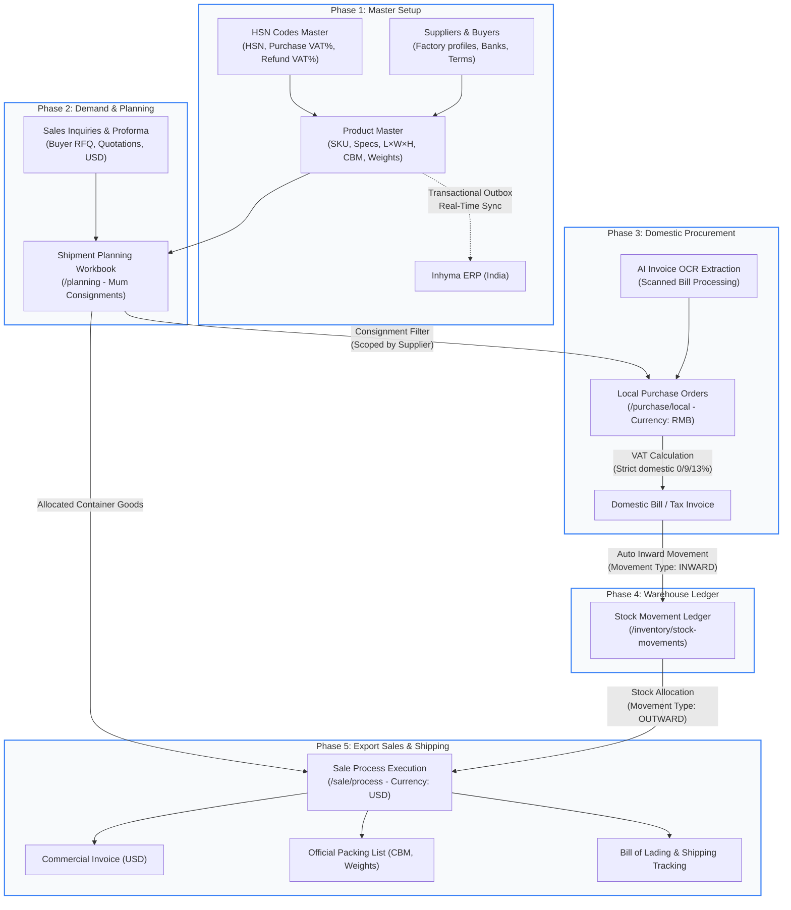

---

## 3. Detailed Module Workflows (Based Strictly on Code)

---

### Module 1: Suppliers Master (`/suppliers`)

#### 1. What It Wants (Business Objective)
To maintain a single, trusted directory of Chinese and international manufacturing vendors, raw material suppliers, packaging fabricators, and trading partners with multi-contact management, factory addresses, and Chinese RMB banking details.

#### 2. What It Does (Core Capabilities)
- Creates, edits, deactivates, and restores supplier profiles.
- Captures legal business name, trade name, factory physical location, and supplier categorization (`SupplierType`).
- Maintains an unlimited list of vendor personnel (Sales Representative, Factory Manager, Accounts) with WeChat IDs, mobile numbers, and emails.
- Stores banking accounts (Beneficiary Name, Bank Name, Account Number, SWIFT / CNAPS code) required for domestic RMB wire transfers.
- Links and catalogs all products manufactured or supplied by each vendor (`SupplierProductLink`).

#### 3. How It Does It (Technical Architecture)
- **Backend Model:** `Supplier` (`backend/app/masters/suppliers/models.py`), `SupplierContact`, `SupplierBankingDetail`, `SupplierProductLink`.
- **API Endpoints:**
  - `GET /api/v1/suppliers` (Paginated list, search by company name, city, supplier type).
  - `POST /api/v1/suppliers` (Creates supplier record with nested contacts and banking).
  - `GET /api/v1/suppliers/{id}` (Full supplier profile).
  - `PUT /api/v1/suppliers/{id}` (Updates profile, contacts, and banking details).
  - `DELETE /api/v1/suppliers/{id}` (Soft deletes supplier, moving to Trash).
- **Data Validations:**
  - Duplicate check enforced on `company_name` (case-insensitive, whitespace-trimmed).
  - Contact validation requires at least one primary phone or WeChat contact.

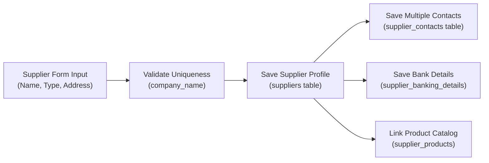

#### 4. Summary
Acts as the root vendor master in China, linking physical manufacturers to products, purchase invoices, and payment tracking.

---

### Module 2: Buyers Master (`/buyers`)

#### 1. What It Wants (Business Objective)
To register and manage all purchasing organizations, corporate buyers, sister companies (e.g., Inhyma India branches), and external international customers importing goods from China.

#### 2. What It Does (Core Capabilities)
- Manages client legal entities, buyer types (`Trader`, `End Customer`, `Sister Company`).
- Maintains international delivery and billing addresses, ports of discharge (e.g. Nhava Sheva, Mundra, Chennai), and payment terms (e.g., 30% Advance / 70% against BL).
- Tracks historical shipments and associated sale orders per buyer.

#### 3. How It Does It (Technical Architecture)
- **Backend Model:** `Buyer` (`backend/app/masters/buyers/models.py`), `BuyerContact`.
- **API Endpoints:**
  - `GET /api/v1/buyers` (List buyers, search by name, country, city).
  - `POST /api/v1/buyers` (Create buyer entity).
  - `PUT /api/v1/buyers/{id}` (Update buyer profile).
  - `DELETE /api/v1/buyers/{id}` (Soft delete).
- **Frontend Page:** `frontend/src/pages/Buyers.tsx`.

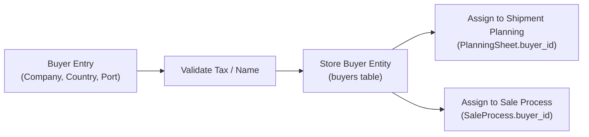

#### 4. Summary
Maintains international client records and destination ports required for export trade documentation and shipping container allocations.

---

### Module 3: Product Master (`/masters/products`)

#### 1. What It Wants (Business Objective)
To serve as the definitive single source of truth for all machines, equipment, spare parts, and packaging goods sourced in China. It governs technical specifications, exact physical measurements, export codes, and cross-system synchronization.

#### 2. What It Does (Core Capabilities)
- Registers product models with SKU code, Product Name (English & Chinese), and Tally Name.
- Links each product to its Category, Sub-Category, Brand, Unit of Measurement (UOM), and primary HSN code.
- Captures exact physical dimensions ($Length \times Width \times Height$ in cm) and automatically computes Unit CBM:
  $$\text{Unit CBM} = \frac{L \times W \times H}{1,000,000}$$
- Stores packaging gross weight ($kg$) and packaging net weight ($kg$).
- Supports multi-angle image uploads (`/api/v1/masters/products/{id}/images`).
- **Real-Time Cross-ERP Sync:** Automatically emits transactional outbox events whenever a product is created, updated, or toggled active/inactive, instantly synchronizing dimensions, CBM, weights, and status to Inhyma ERP (India).

#### 3. How It Does It (Technical Architecture)
- **Backend Model:** `Product` (`backend/app/masters/products/models.py`).
- **Database Fields:**
  - Identifiers: `id`, `sku`, `product_name`, `product_name_tally`, `hsn_code_id`, `category_id`, `sub_category_id`, `uom_id`, `brand_id`.
  - Dimensions: `length`, `width`, `height`, `length_cm`, `width_cm`, `height_cm`, `packaging_unit_cbm`, `packaging_gross_weight`, `packaging_net_weight`.
  - Taxes: `purchase_vat_percent` (Domestic China), `refund_vat_percent` (Export refund).
  - Status: `is_active`, `status` (`ACTIVE` / `INACTIVE`).
- **Sync Architecture:** `app/masters/products/sync_inhyma.py` writes to `integration_outbox_events` within the database transaction, then initiates immediate HTTP dispatch with retry fallback.

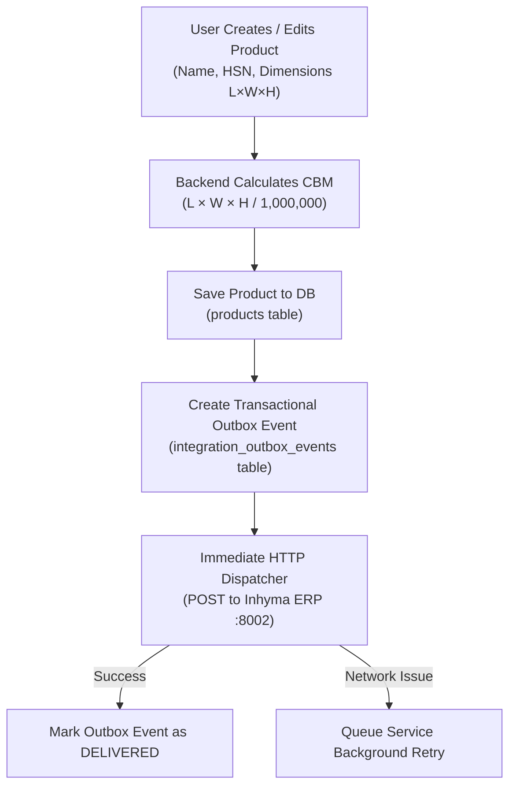

#### 4. Summary
The technical anchor of the ERP. Guarantees that logistics volume, domestic procurement taxes, and international master records stay synchronized across both ERPs.

---

### Module 4: Product Prices Directory (`/inventory/product-prices`)

#### 1. What It Wants (Business Objective)
To maintain accurate purchasing price history and tiered selling price catalogs for products across different suppliers, currencies, and volume tiers.

#### 2. What It Does (Core Capabilities)
- Stores price lists linked to specific products and suppliers.
- Supports multi-currency pricing (RMB for domestic purchase price, USD for export quotation price).
- Records minimum order quantity (MOQ) brackets and price validity start/end dates.

#### 3. How It Does It (Technical Architecture)
- **Backend Model:** `ProductPrice` (`backend/app/masters/products/models.py`).
- **API Endpoints:**
  - `GET /api/v1/inventory/product-prices` (Filter by product, supplier, currency).
  - `POST /api/v1/inventory/product-prices` (Add price record).
  - `PUT /api/v1/inventory/product-prices/{id}` (Update price).
- **Calculations:** Used by Local Purchase and Sale Process to suggest default unit prices.

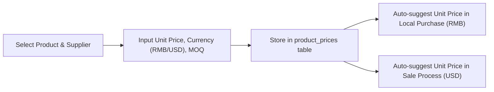

#### 4. Summary
Provides historical and active commercial pricing for procurement and export sales.

---

### Module 5: Shipment Planning Workbook (`/planning`)

#### 1. What It Wants (Business Objective)
To provide an interactive, real-time spreadsheet grid that models container shipments (`Mum 48`, `Mum 49`, `Mum 50`, etc.) from China to global destinations, allowing logistics officers to track requirement approvals, order placements, container loadings, and total shipment volume (CBM).

#### 2. What It Does (Core Capabilities)
- Multi-sheet workbook navigation: Each sheet represents an operational branch or entity (e.g. `Inhyma Mumbai`, `Inhyma Ahmedabad`, `One Stop`, `Prathamesh Packaging`).
- **Universal Entity Selector (`All Entities`):** Allows viewing all sheets across all organizations and buyers simultaneously, or filtering to a specific entity. Clicking any sheet tab immediately loads its spreadsheet grid.
- **Dynamic Columns:** Unlimited admin-defined columns for consignment batches (`Mum 48`, `Mum 48 Remarks`, `Approval Date`, `Test Y/N`).
- **Interactive CRM Status Tags:** Visual swatches on cells (Red = requirement raised, Blue = ordered from vendor, Green = purchased/confirmed, custom tags).
- **Auto CBM Volume Accumulator:** Automatically calculates row volume and total container load against container capacities ($20\text{ft} = 28\,\text{CBM}$, $40\text{ft HQ} = 68\,\text{CBM}$).
- **Audit History Drawer:** Immutable change log recording every cell edit, timestamp, old value, and new value.

#### 3. How It Does It (Technical Architecture)
- **Backend Architecture:** `app/planning/models.py` (`PlanningSheet`, `PlanningColumn`, `PlanningRow`, `PlanningCell`, `PlanningChangeLog`).
- **API Endpoints:**
  - `GET /api/v1/planning/sheets` (List all workbook sheets).
  - `GET /api/v1/planning/sheets/{id}/grid` (Paginated grid rows, cells, and calculated column aggregates).
  - `POST /api/v1/planning/cells` (Save cell value or color status, writes audit entry).
  - `POST /api/v1/planning/columns` (Add new consignment or custom column).
- **Data Caching & Pagination:** Virtualized table with server-side pagination (`GRID_PAGE_SIZE = 50`) and localStorage caching for pinned/frozen columns.

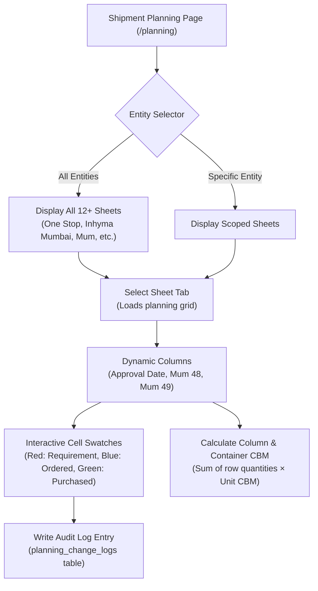

#### 4. Summary
The central operational command center for consolidating container shipments from China across multiple factories before procurement and shipping.

---

### Module 6: Local Purchase Domestic Procurement (`/purchase/local`)

#### 1. What It Wants (Business Objective)
To execute domestic Chinese purchasing contracts with manufacturers in RMB (CNY). It converts planned items into formal vendor orders, extracts invoice details via AI OCR, and strictly isolates Chinese domestic Purchase VAT from foreign taxes.

#### 2. What It Does (Core Capabilities)
- **Supplier-Scoped Consignment Filtering:** When selecting a container consignment (`Mum 48`), the system extracts only the items manufactured by the selected vendor, isolating multi-vendor container goods.
- **AI Scanned Invoice OCR Extraction:** Users upload scanned paper bills or PDFs; an integrated OpenAI Vision OCR pipeline parses the Chinese supplier name, line items, quantities, and prices automatically.
- **Domestic Purchase VAT % Resolution:** Resolves domestic Chinese input VAT (`进项税`) strictly from:
  $$\text{VAT Rate} = \text{hsn.purchase\_vat\_percent} \;\to\; \text{product.purchase\_vat\_percent} \;\to\; 0.00\%$$
  Explicitly excludes Indian GST (18%) and China Export Refund VAT (13%).
- **Financial Calculations:**
  $$\text{Line Tax} = \text{Amount} \times \left(\frac{\text{VAT Rate}}{100}\right)$$
  $$\text{Line Total} = \text{Amount} + \text{Line Tax}$$
- **Automatic Stock Inward:** Upon confirming bill receipt, line item quantities are automatically added into the China warehouse stock register.

#### 3. How It Does It (Technical Architecture)
- **Backend Service:** `LocalPurchaseService` (`backend/app/purchases/local/service.py`).
- **Database Tables:** `local_purchases`, `local_purchase_items`, `local_purchase_invoices`.
- **API Endpoints:**
  - `GET /api/v1/purchases/local` (List purchase orders).
  - `POST /api/v1/purchases/local` (Create purchase order with items).
  - `GET /api/v1/purchases/local/consignments/{column_id}/items?supplier_id={id}` (Extracts vendor-filtered container goods).
  - `POST /api/v1/purchases/local/extract-bill` (AI OCR extraction endpoint).
- **Frontend Form:** `frontend/src/pages/purchases/LocalPurchaseForm.tsx`.

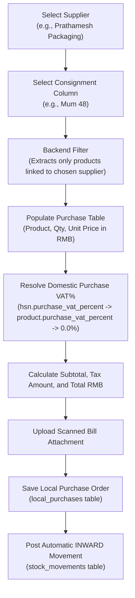

#### 4. Summary
Controls all domestic procurement spending in China, ensuring accurate VAT accounting and automated inventory receiving.

---

### Module 7: Inventory Ledger & Stock Movement (`/inventory/stock-movements`)

#### 1. What It Wants (Business Objective)
To maintain an immutable, double-entry audit trail of physical goods in the Chinese warehouse, distinguishing between stock received from factories and stock stuffed into shipping containers for export.

#### 2. What It Does (Core Capabilities)
- **Inward Movements (`INWARD`):** Goods received from Local Purchases, physical count corrections, or vendor replacements.
- **Outward Movements (`OUTWARD`):** Goods dispatched and loaded into shipping containers against Sale Process orders.
- **Real-Time Balance Ledger:** Computes active available balance per product SKU:
  $$\text{Current Stock} = \sum \text{Inward Quantities} - \sum \text{Outward Quantities}$$
- Filters movements by Date Range, Movement Type, Product, and Reference Number.

#### 3. How It Does It (Technical Architecture)
- **Backend Model:** `StockMovement` (`backend/app/stock/models.py`), `StockItem`.
- **API Endpoints:**
  - `GET /api/v1/stock/movements` (Paginated list of historical movements).
  - `POST /api/v1/stock/movements` (Manual inward/outward movement entry).
  - `GET /api/v1/stock/summary` (Aggregated real-time stock balances per product).
- **Integrity Enforcement:** Database triggers and service checks prevent outward movements from driving stock balances negative unless explicitly configured.

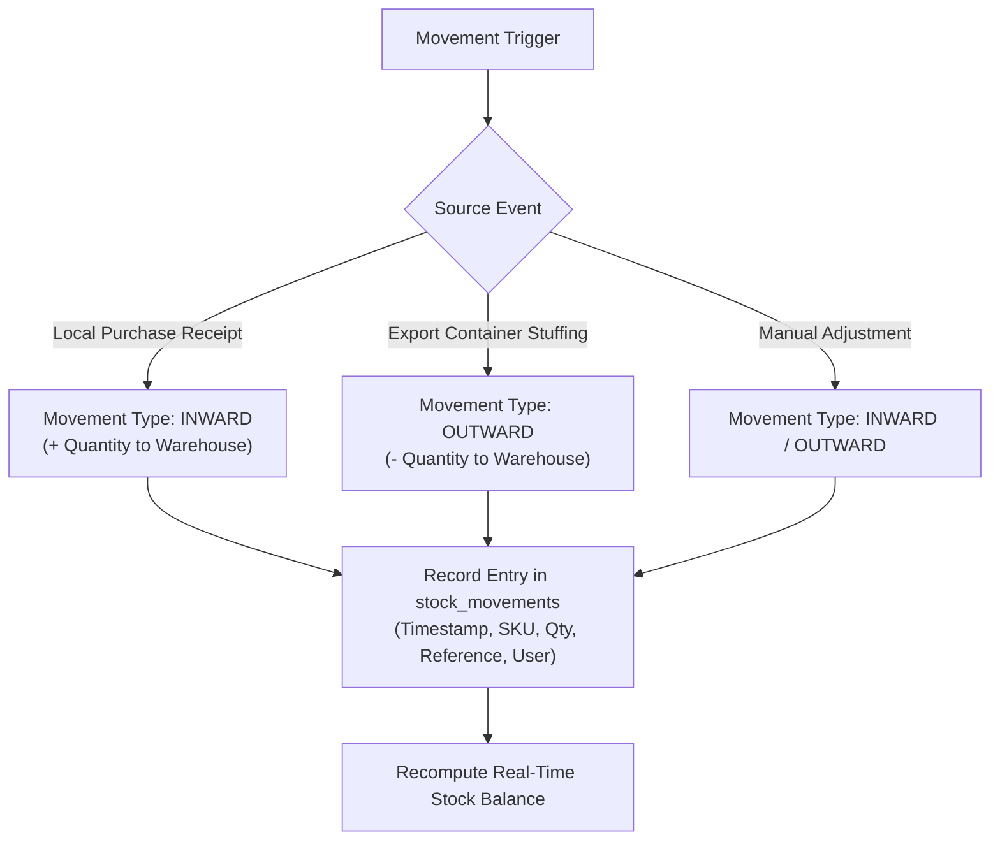

#### 4. Summary
Provides complete visibility of physical inventory sitting in China awaiting export shipping.

---

### Module 8: Sales Module — Inquiries & Proforma (`/inquiries`)

#### 1. What It Wants (Business Objective)
To manage customer inquiries (RFQs) and issue formal Proforma Invoices (PI) in international currencies (USD) before manufacturing orders are finalized.

#### 2. What It Does (Core Capabilities)
- Logs customer requests with requested products, target delivery dates, and required quantities.
- Computes proforma totals, commercial terms (FOB Ningbo / CIF Mumbai), and advance payment requirements.
- Generates downloadable Proforma Invoice PDFs with corporate letterhead, payment bank instructions, and authorized signature.
- Tracks inquiry status transitions: `DRAFT` $\to$ `QUOTED` $\to$ `CONFIRMED` $\to$ `CONVERTED_TO_SALE`.

#### 3. How It Does It (Technical Architecture)
- **Backend Model:** `Inquiry` (`backend/app/sales/models.py`), `InquiryItem`.
- **API Endpoints:**
  - `GET /api/v1/sales/inquiries` (List customer inquiries).
  - `POST /api/v1/sales/inquiries` (Create inquiry / proforma).
  - `PUT /api/v1/sales/inquiries/{id}` (Update items, terms, pricing).
  - `POST /api/v1/sales/inquiries/{id}/convert` (Promotes inquiry into formal Sale Process order).

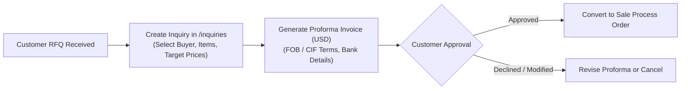

#### 4. Summary
The preliminary sales front-end, capturing commercial demand before committing factory production.

---

### Module 9: Sales Module — Sale Process & Official Export Trade Documentation (`/sale/process`)

#### 1. What It Wants (Business Objective)
To execute official international export sales contracts. It manages container allocations, generates legally compliant export trade documents for customs and banks, and tracks China Export Refund VAT (`出口退税`).

#### 2. What It Does (Core Capabilities)
- Tracks order execution from container allocation to port departure:
  $$\text{DRAFT} \;\to\; \text{CONFIRMED} \;\to\; \text{IN_PRODUCTION} \;\to\; \text{STUFFED} \;\to\; \text{SHIPPED} \;\to\; \text{COMPLETED}$$
- **Commercial Invoice (CI) Generation:** Computes total USD sales amounts, payment terms, and bank details.
- **Export Packing List (PL) Generation:** Calculates container net weights, gross weights, total packages, carton counts, and total CBM across all lines.
- **China Export Refund VAT Calculation:** Applies `product.refund_vat_percent` (e.g. 13%) for tax refund eligibility documentation with Chinese customs and tax authorities.
- **Shipping Logistics Tracking:** Captures Container Number, Seal Number, Vessel Name, Port of Loading (e.g., Ningbo / Shanghai), Port of Discharge, and Bill of Lading (BL) Number.

#### 3. How It Does It (Technical Architecture)
- **Backend Service:** `SaleProcessService` (`backend/app/sales/service.py`).
- **Database Tables:** `sale_processes`, `sale_process_items`, `commercial_invoices`, `packing_lists`.
- **API Endpoints:**
  - `GET /api/v1/sales/process` (List export orders).
  - `POST /api/v1/sales/process` (Create export order).
  - `GET /api/v1/sales/process/{id}/commercial-invoice` (Generates official CI dataset).
  - `GET /api/v1/sales/process/{id}/packing-list` (Generates official PL dataset).
- **Frontend:** `frontend/src/pages/sales/SaleProcessList.tsx`, `SaleProcessForm.tsx`.

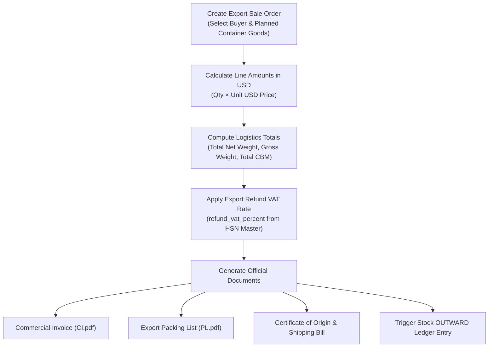

#### 4. Summary
The export commercial engine of Yinglima ERP, generating all documents required for international shipping, customs clearance, and foreign exchange receipts.

---

### Module 10: Configuration Masters (`/masters/*`)

#### 1. What It Wants (Business Objective)
To provide unified configuration tables governing taxation, currencies, measurement units, product classifications, and global geography across the application.

#### 2. What It Does (Core Capabilities)
- **HSN Codes Master (`/masters/hsn`):** Defines 4-digit, 6-digit, and 8-digit Harmonized System codes. Uniquely maintains:
  1. `purchase_vat_percent`: Domestic China Input VAT (e.g. 0%, 9%, 13%).
  2. `refund_vat_percent`: China Export Refund VAT (e.g. 13%).
  3. `gst_percent`: Indian Goods & Services Tax (e.g. 18%) utilized exclusively for cross-ERP sync to Inhyma.
- **Categories & Sub-Categories (`/masters/categories`, `/masters/subcategories`):** Two-tier hierarchy grouping products (e.g. Packaging Machinery $\to$ Band Sealers, Vacuum Sealers).
- **Units of Measurement (`/masters/uom`):** Defines standard trade units (`PCS`, `SETS`, `ROLLS`, `BOXES`, `KGS`).
- **Geography Masters (`/masters/countries`, `/masters/states`, `/masters/cities`):** Standardizes international shipping ports and addresses.
- **Currencies (`/masters/currencies`):** Manages operational currencies (`RMB`, `USD`, `INR`, `EUR`) and exchange rates.
- **Company / Internal Organizations List (`/masters/company-list`):** Configures legal operating entities and branch offices (`Inhyma`, `One Stop`, `F&B`, `Darsh Impex`).

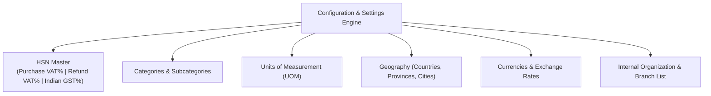

#### 4. Summary
Guarantees clean, relational referential integrity across the entire enterprise database.

---

### Module 11: User Management & Granular RBAC (`/users`, `/positions`, `/rbac`)

#### 1. What It Wants (Business Objective)
To protect confidential procurement costs, prevent unauthorized price manipulations, and restrict feature access based on job roles and company departments.

#### 2. What It Does (Core Capabilities)
- **User Accounts (`/users`):** Administers logins, passwords (bcrypt encrypted), email addresses, and active/disabled statuses.
- **Positions (`/positions`):** Defines organizational titles (e.g. Sourcing Specialist, Logistics Manager, Finance Director).
- **Departments & Granular Permissions (`/rbac`):** Matrix assigning granular permission keys to roles:
  - `product.create`, `product.edit`, `product.delete`
  - `local_purchase.view`, `local_purchase.create`, `local_purchase.edit`
  - `planning.view`, `planning.cell.edit`, `planning.column.manage`
  - `sale_process.create`, `sale_process.invoice.generate`
- Features automatic permission enforcement on both backend routes (`Depends(require_permission(...))`) and frontend UI components (`<Can permission="...">`).

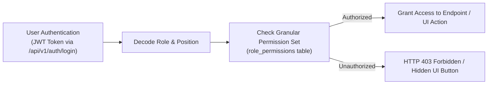

#### 4. Summary
Enforces enterprise security, data privacy, and separation of duties across all staff members.

---

### Module 12: Cross-ERP Transactional Outbox Sync Engine

#### 1. What It Wants (Business Objective)
To maintain real-time master data consistency between **Yinglima ERP** (China procurement office) and **Inhyma ERP** (India corporate headquarters), preventing manual double entry of product specifications, dimensions, and statuses.

#### 2. What It Does (Core Capabilities)
- Implements the **Transactional Outbox Pattern**: Product mutations and sync events are written into the database within the *same* atomic database transaction.
- Calculates payload SHA-256 checksums to guarantee data integrity over the wire.
- Maintains strict monotonic versioning (`sync_version`) to ensure Inhyma's Optimistic Concurrency Control (OCC) never rejects updates or allows out-of-order execution.
- Dispatches HTTP sync events immediately (`< 150ms` latency), with an asynchronous background worker for retry recovery upon network interruptions.
- Syncs: Product Name, SKU, HSN Code, Length, Width, Height, Unit CBM, Gross Weight, Net Weight, Material, Color, and Active/Inactive Status.

#### 3. How It Does It (Technical Architecture)
- **Backend Components:** `backend/app/masters/products/sync_inhyma.py`, `backend/app/integration/service.py`.
- **Database Tables:** `integration_outbox_events`, `integration_deliveries`.
- **Target Endpoint:** `POST http://<inhyma-host>:8002/api/v1/integration/receive-sync`.

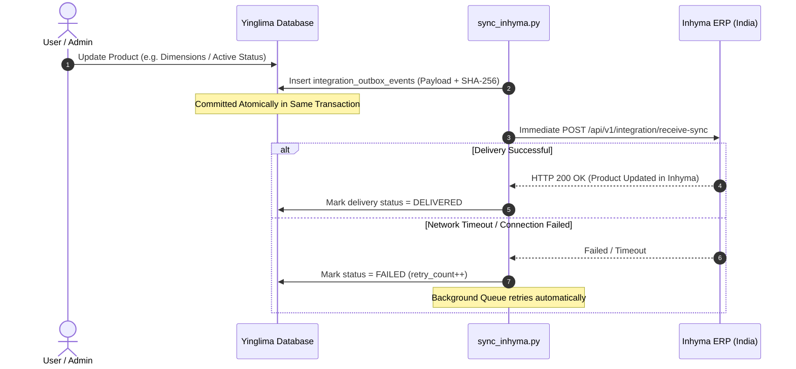

#### 4. Summary
Provides fully automated, zero-latency master data replication from China to India with zero duplicate data entry.

---

## 4. Master Architectural Summary Table

| Module Name | Router Path | Primary Backend Service / Model | Key Business Outputs |
| :--- | :--- | :--- | :--- |
| **Suppliers** | `/suppliers` | `Supplier` (`suppliers/models.py`) | Chinese vendor directory, factory contacts, WeChat IDs, RMB bank accounts |
| **Buyers** | `/buyers` | `Buyer` (`buyers/models.py`) | Global customer registry, delivery ports, billing terms |
| **Product Master** | `/masters/products` | `Product` (`products/models.py`) | Single source of truth, SKU, HSN, $L \times W \times H$, CBM, Outbox Sync |
| **Product Prices** | `/inventory/product-prices` | `ProductPrice` (`products/models.py`) | Historical vendor purchasing prices (RMB) and export prices (USD) |
| **Shipment Planning** | `/planning` | `PlanningService` (`planning/service.py`) | Visual container workbook (`Mum 48`), CBM calculator, status tracking |
| **Local Purchase** | `/purchase/local` | `LocalPurchaseService` (`purchases/local/service.py`) | Domestic RMB orders, supplier consignment filter, AI OCR, domestic VAT (0/9/13%) |
| **Stock Movement** | `/inventory/stock-movements` | `StockMovement` (`stock/models.py`) | Inward/Outward physical warehouse inventory ledger in China |
| **Sale Inquiries** | `/inquiries` | `Inquiry` (`sales/models.py`) | Customer RFQ quotation management, official Proforma Invoices (USD) |
| **Sale Process** | `/sale/process` | `SaleProcessService` (`sales/service.py`) | Export orders, USD Commercial Invoices, Packing Lists, BL tracking |
| **HSN Master** | `/masters/hsn` | `HsnCode` (`hsn/models.py`) | 3-way tax resolution: Domestic Purchase VAT, Refund VAT, Indian GST |
| **RBAC & Users** | `/rbac`, `/users` | `UserService`, `Role` (`users/models.py`) | JWT authentication, granular permission matrix, role department controls |
| **Cross-ERP Sync** | Background Event Engine | `IntegrationOutboxEvent` (`sync_inhyma.py`) | Real-time automated replication to Inhyma India via transactional outbox |

---
*Manual compiled directly from active production code in `d:\Om work1\ERP\Yinglima_ERP`.*
